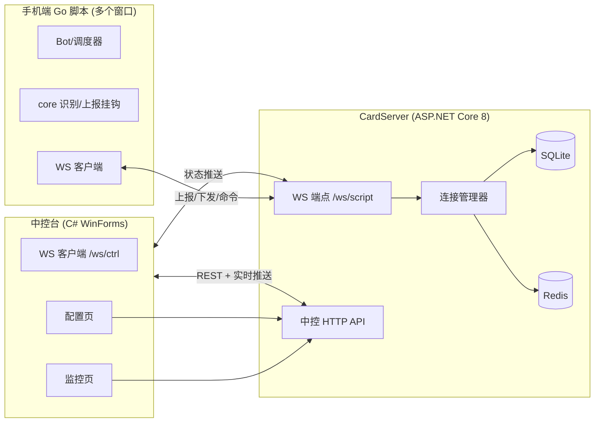

## 产品概述
为现有手游自动化脚本项目（Go，e:/autogo/ql）新增一套**远程中控系统**，让用户在中控台上一眼看到所有脚本窗口的运行状态与角色数据，并能批量下发配置。中控台是 C# WinForms 桌面程序，服务端直接加在项目现有的 CardServer（C# ASP.NET Core 8）上，手机端复用现有 Go 脚本。**本次任务只产出方案文档，不写实现代码。**

## 核心功能

### 1. 监控页（按参考图 1:1 复刻）
- 顶部标签栏：监控 / 配置 / 产出明细 / 更新日志 / 使用说明；右侧显示"服务端通信正常"状态
- 公告栏：一行滚动公告文字
- 第一行工具栏：全选、反选、统计（先留空位）、已选择 N/M、配置下拉、"导入配置"、"导入代理"（先留空位）
- 第二行工具栏：停止、重启、刷新、勾选相同配置、移除设备、重置脚本（不做"重置每日"，不加启动/暂停/恢复）
- 右上统计区：当前在线、累计设备、授权窗口、到期时间
- 设备表格列：勾选框、序号、设备编号、区服、角色、职业、等级、战力、金币、钻石、今日钻石、当月钻石、背包剩余、配置、状态
- 状态取值：运行中 / 暂停 / 停止 / 离线（离线保留行、置灰）
- 去掉的列：时装、翅膀、坐骑、宝石、勋章、账号密码、今日/当月产出、用户类型、登录账号

### 2. 配置页（图形化表单，按参考图 2）
- 字段：装备强化数量上限（数字框）、自动分解配置（一般/高级/稀有复选）、扩展背包配置（数字框）、优先挂机点（下拉选 1 个，选项来自服务端挂机点池）、背包页签名单（上下两层表格：页签 + 物品）、默认颜色（多选框）、自动上架（复选）、排除（下拉选物品，选项来自所选页签的物品列表）、物品模式（下拉 7 选项）、物品装备强化等级（数字框）
- 隐藏"识别引用"；不显示"境界配置"（保留手机内置值）
- 可保存多份配置（如方案A/方案B）

### 3. 配置存储与下发
- 配置存在服务端、绑定卡密；中控下发时逐项合并，未下发的项（如境界配置）保留手机内置值
- 下发时设备必须在线；重启脚本后生效
- "配置"列显示哪套方案由服务端记账

### 4. 数据上报
- 上线报全量；心跳只报存活（30 秒）；等级/战力/金币/钻石/状态/任务变化时立即上报；角色/职业登录完成后读一次
- 离线判定：90 秒无心跳或连接断开

### 5. 今日/当月钻石（A 净增）
- 今日钻石 = 当前钻石 - 今日基准；当月钻石 = 当前钻石 - 当月基准
- 基准每天 0 点/每月 1 号更新，设备首次上线时=当前值；负数显示 0；每台设备一份

### 6. 明确不做
- 不做截图、不做远程点击/滑动/输入、不做 Web 网页版、不看发卡人归属


## 技术栈
- 手机端：沿用 Go（app 模块，现有 bot/task/core/plugin 架构），WebSocket 客户端
- 中控服务端：C# ASP.NET Core 8，直接加在现有 `cardManager/CardServer`，复用 SQLite + Redis + Cookie 认证
- 中控台：C# WinForms（.NET 8），放 `ql/control/`
- 通信：WebSocket 长连 + 30 秒心跳 + JSON `{type, params}`
- 序列化：服务端沿用现有 camelCase JSON 策略

## 实现方案

### 整体策略
复用 CardServer 的 SQLite/Redis/认证与 ql 的调度/插件回调体系，新增一条"中控通道"（WS），不改动既有卡密校验链路。三个角色：
1. 脚本端（Go）：主动连服务端 WS，上报数据；收到下发配置后写入文件，等重启生效
2. 服务端（CardServer）：维护在线连接、窗口注册表、配置方案、挂机点池、今日/当月基准；提供 HTTP API 给中控台
3. 中控台（WinForms）：卡密登录后拉设备列表与配置，通过 HTTP API 操作，底部保持与服务的连通状态显示

### 关键决策与理由
- **WS 由脚本端主动连入（反向连接）**：与现有 `cardkey` 心跳上报思路一致，手机在 NAT 后无需公网端口；服务端用 `ConnectionManager` 持有连接
- **数据上报挂钩读取点而非定时轮询**：等级/战力只在特定界面可读（主界面 HUD），跑任务时读不到，所以挂在 `GetLevel`/`GetCachedTextInt` 的成功分支，读到且与上次不同才上报，零额外开销
- **配置逐项合并而非整体替换**：手机 `assets/脚本配置.json` 有内置默认（境界配置等中控不显示的字段），整体替换会丢字段；逐项合并最安全
- **配置下发后重启生效**：避免热加载带来的状态不一致，符合项目"重启不热更"的既有习惯
- **今日/当月钻石用服务端差值统计**：游戏无对应文字，用"当前钻石 - 基准"最直观；基准存在服务端，定时任务更新
- **中控台操作走 HTTP，实时数据走 WS**：下载/下发/列表是请求-响应语义，HTTP 更简单；设备实时状态推送走 WS 便于秒级刷新
- **中控台另有"命令下发"通道**：停止/重启/重置脚本通过服务端转发到指定窗口的 WS 连接，脚本端执行后回执

### 性能与可靠性
- 上报采用"变化即报 + 心跳保活"，避免定时全量轮询造成流量与识别开销
- 服务端连接与在线状态走 Redis（复用 WindowTable 思路），列表读取走内存注册表，复杂度 O(设备数)
- 中控台表格用虚拟模式（VirtualMode）承载大量行，避免大量行时 UI 卡顿
- 离线设备保留显示、状态置灰，避免列表跳变

## 实施注意
- **务必复用既有模式**：服务端参考 `WindowTable`/`CardApiController` 的写法；Go 端参考 `plugin` 回调注入（`SetRunTaskFunc` 等）与 `core` 日志/识别封装，不引入新框架
- **上报挂点**：`core.GetLevel`、`core.GetCachedTextInt`（战斗力）在识别成功分支上报；任务/状态变化在 `bot` 的 StateMachine/Scheduler 回调上报
- **识别缺失**：区服/角色/职业/金币/钻石/背包剩余在 `recogs.json` 中暂无预设，本方案只定义上报字段与挂点，具体识别区域待用户后续提供后补齐（不臆造坐标）
- **阈值配置**：新增识别预设时若用户给 1/1.000 才写 0.95，其他值原样写入（遵循项目约定）
- **不自动跑校验**：文档与代码完成后不执行 gofmt/go vet/JSON 校验，交用户自行验证
- **blast radius**：不改动既有卡密/热更/任务引擎逻辑；`client/wsclient.go` 为旧注释文件，重写时保持文件位置、不波及 `main.go` 主流程（新增初始化点）
- **安全**：WS 连接需携带卡密与设备号身份，服务端校验卡密有效性后再接受注册；不传输密码等敏感信息到中控展示

## 架构设计



### 组件关系
- **脚本端**：`wsclient` 负责连接、上报、接收下发的配置与命令；配置写入 `assets/脚本配置.json` 的合并结果，命令由 `bot` 回调执行
- **服务端**：`ConnectionManager` 管理在线脚本/中控连接；`CtrlApiController` 提供登录、设备列表、配置 CRUD、下发、命令转发；`DiamondStats` 维护今日/当月基准并定时重置
- **中控台**：`ApiClient` 封装 HTTP，`CtrlSocket` 接收推送并刷新表格；MonitorForm/ConfigForm 对应两个页签

## 目录结构

```text
e:/autogo/ql/
├── plan/
│   └── 中控系统方案.md                    # [NEW] 本次唯一交付物：完整方案文档
├── cardManager/CardServer/
│   ├── Program.cs                        # [MODIFY] 注册 ConnectionManager/DiamondStats，映射 WS 端点与中控 API
│   ├── Controllers/
│   │   └── CtrlApiController.cs          # [NEW] 中控登录/设备列表/配置 CRUD/下发/命令转发
│   ├── WebSocket/
│   │   ├── ScriptSocketEndpoint.cs       # [NEW] /ws/script：脚本端连接、注册、上报接收、命令下发
│   │   └── CtrlSocketEndpoint.cs         # [NEW] /ws/ctrl：中控台连接、实时状态推送
│   ├── Services/
│   │   ├── ConnectionManager.cs          # [NEW] 脚本/中控连接注册表与广播
│   │   ├── DiamondStats.cs               # [NEW] 今日/当月钻石基准与定时重置
│   │   └── CtrlConfigService.cs          # [NEW] 配置方案存储、逐项合并、挂机点池
│   ├── Data/
│   │   ├── AppDbContext.cs               # [MODIFY] 新增 CtrlConfig/CtrlDevice/DiamondBase/HangPoint 实体
│   │   └── Models/                       # [NEW] 上述实体类
│   └── wwwroot/                          # 不改动（中控走 WinForms）
├── control/                              # [NEW] 中控台 WinForms 项目
│   ├── Control.csproj                    # [NEW] .NET 8 WinForms 工程
│   ├── Program.cs                        # [NEW] 应用入口
│   ├── Forms/
│   │   ├── LoginForm.cs                  # [NEW] 卡密登录
│   │   ├── MainForm.cs                   # [NEW] 主窗体：标签页 + 工具栏 + 表格
│   │   ├── ConfigForm.cs                 # [NEW] 配置页图形化表单
│   │   └── StatsForm.cs                  # [NEW] 统计弹窗（先留空位）
│   ├── Controls/
│   │   └── DeviceGridView.cs             # [NEW] VirtualMode 设备表格
│   └── Services/
│       ├── ApiClient.cs                  # [NEW] HTTP 封装
│       └── CtrlSocket.cs                 # [NEW] 中控 WS 客户端
├── client/
│   └── wsclient.go                       # [MODIFY] 重写：连服务端、上报、接收下发/命令
├── bot/
│   └── bot.go                            # [MODIFY] 新增中控上报/命令回调挂钩
├── core/
│   └── level.go                          # [MODIFY] GetLevel/GetCachedTextInt 成功分支上报
└── assets/
    └── 脚本配置.json                      # [MODIFY] 接收逐项合并后的配置（运行时写入）
```

## 关键数据结构（服务端）

- `CtrlConfig`：Id、CardCode、SchemeName、ConfigJson、HangPointId、UpdatedAt
- `CtrlDevice`：WindowId、CardCode、DeviceNo、Server、Role、Job、Level、Power、Gold、Diamond、TodayDiamond、MonthDiamond、BagFree、SchemeName、State、LastSeen
- `DiamondBase`：WindowId、TodayBase、MonthBase、UpdatedAt
- `HangPoint`：Id、Name、MapName、MinLevel、MinPower、SwitchTimes、Enabled


## 设计定位
中控台为 Windows 桌面程序（C# WinForms），采用**浅色简洁专业风格**（白底 + 浅灰卡片 + 蓝色主色），信息密度高、层次清晰、操作高效，长时间盯屏也不刺眼，符合"工作室级后台"的干净稳重感。

## 布局架构
- 主窗体顶部为标签栏（监控 / 配置 / 产出明细 / 更新日志 / 使用说明），右侧固定显示服务端连通状态指示灯（绿点 + 文字）
- 监控页自上而下：公告栏 → 第一行工具栏 → 第二行工具栏 → 右上统计区与表格同区 → 设备表格（虚拟模式，占满剩余高度）→ 状态栏
- 配置页左侧为子页签（基础配置 / 副本日常 / 拍卖提战），右侧为图形化表单区，表单用分组框分区，行内控件左右对齐
- 表格行、按钮统一圆角与悬停高亮，选中行整行变色

## 交互与响应
- 勾选、全选、反选、勾选相同配置即时反馈；批量按钮对选中行生效，未选中时给出提示
- 下发的设备离线时禁用按钮并提示"设备必须在线"
- 状态列用颜色区分：运行中绿、暂停黄、停止红、离线上灰；数据变化时行内单元格局部刷新，不整表重绘
- 窗口自适应：最小尺寸约束，表格列随窗口宽度按权重分配

## Agent Extensions
### Skill
- **lsp-code-analysis**
  - Purpose: 在实现阶段对 Go/C# 代码做语义级跳转与引用分析（如查 `GetLevel`/`GetCachedTextInt` 的全部调用点、`plugin` 回调注入点、服务端 `WindowTable` 用法）
  - Expected outcome: 精确定位上报挂钩点与需改动文件，避免遗漏调用方与误改无关代码
### SubAgent
- **code-explorer**
  - Purpose: 批量探查 CardServer 现有控制器/服务/模型与 ql 端 bot/core/plugin/client 的结构细节
  - Expected outcome: 产出准确的改动清单与既有约定（命名、JSON 策略、错误处理）供文档与后续实现引用
