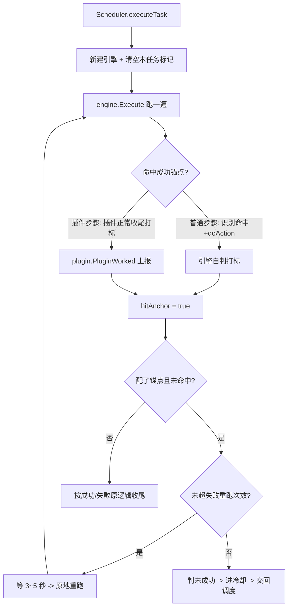

## 需求概述
为 ggsj 任务系统增加「任务级重跑」能力：任务真正跑完设计好的收尾步骤才算成功；否则自动重跑，避免"打开界面就算成功"的假成功。

## 核心功能
1. **成功锚点**：任务 JSON 头部新增 `成功锚点`（数组，任一命中即算成功）与 `失败重跑`（次数）。
2. **锚点判定（对外一套，对内两分支）**：
   - 普通步骤锚点（如 `退出`、`主线进行中`、`关闭`、`挂机中`）：该步骤在主流程中识别命中并真正执行了动作即算命中。
   - 插件步骤锚点（如 `福利领取`、`自动买药`）：插件走到"正常收尾路径"并上报打标才算命中；插件仅返回 ok 不算成功。
3. **两条正常收尾路径都算成功**：① 有东西可干→干完结束；② 没东西可干（红点已领完/不缺药/背包已空）→ 正常空手结束。中途卡住、识别不到界面而提前失败返回的，不算成功。
4. **重跑机制**：未命中任何锚点 → 判未成功；未超 `失败重跑` 次数时，在任务执行内部**当场等 3~5 秒后完整重跑一遍**（不走调度器、不被高优先级任务抢），每遍独立计时独立超时；次数用尽 → 按 JSON `冷却秒` 正常进冷却，交回正常调度。
5. **超时不算失败**，保持原行为。
6. **子任务不受影响**：是否判定锚点，只看该任务自己的 JSON 有没有配锚点；子任务目标 JSON 未配则不判；日后改为自动调度并配了锚点即自然生效。打标按任务名隔离，防止外层任务跑子任务时串标。

## 最终锚点表
| 任务 | 成功锚点 | 类型 |
|---|---|---|
| 成长 / 加护 / 气运显现 / 画册 / 灵力修炼 / 门派战斗 / 领取成就 / 领取邮件 | ["退出"] | 普通步骤 |
| 主线任务 | ["主线进行中"] | 普通步骤 |
| 支线任务 | ["支线进行中"] | 普通步骤 |
| 背包物品 | ["关闭"] | 普通步骤 |
| 福利领取 | ["福利领取"] | 插件步骤 |
| 自动买药 | ["自动买药"] | 插件步骤 |
| 每日任务 / 野外挂机 / 落花战场 | ["挂机中"] | 插件步骤 |

## 本次交付
仅产出方案文档，保存到项目根目录 `plan/` 文件夹，暂不改动任何代码。


## 技术栈
- 沿用项目现有 Go 技术栈与架构（分层：`plugin` 业务插件 / `task` 引擎 / `bot` 调度），不引入新框架。
- 数据仍走 JSON 配置（`assets/tasks/*.json`），新增字段由 `task.TaskConfig` 的 json tag 映射。

## 实现思路
### 对外一套、对内两分支
新增字段只有一份（`成功锚点`/`失败重跑`），判定入口只有一处（引擎 `markAnchorIfHit`），但命中来源分两支：
- 普通步骤：引擎在 `runNode` 主流程里"识别命中 + `doAction` 执行"后自行打标（引擎自判）。
- 插件步骤：引擎在插件返回 ok 后，读 `plugin.PluginWorked(任务名)` 是否被置位（插件上报）。

这样任务 JSON 写法完全统一，用户无需关心来源差异；差异只落在引擎内部一个分支判断上。选择此方案的原因：信息本身分布在两处（引擎看得见的动作 vs 插件才知道的内部产出），强行统一为单一来源会导致通用机制（弹窗插队/重试/声明式路由）被迫下沉到每个插件，改动量与回归风险剧增。

### 插件打标规则（关键决策）
- 打标**不打在"点中某个目标"那行**，而是打在插件的**正常收尾 return 分支**上：既覆盖"有东西干完"，也覆盖"没东西可干正常结束"。
- 中途 `return "no"`（卡住/失败）一律不打标。
- 打标带任务名（`ctx.TaskName`），任务级隔离，避免 `野外挂机` 跑子任务时子任务打标串进外层判定。
- 插件 ok 不等于成功：必须"返回 ok + 已打标"才认定锚点命中。

### 重跑落点
重跑循环放在 `bot/scheduler.go` 的 `executeTask` 内部（而非调度器 `tick`），保证：
- 单飞锁 `s.running` 全程不释放，重跑期间其它任务无法插入；
- 重跑为"原地紧接着再跑"，不经过 `PickNext`、不受优先级影响；
- 每遍新建 `context` 与引擎，独立计时独立超时。

### 性能与可靠性
- 打标为 O(1) 的原子/映射读写，无额外截图或识别开销；判定在引擎返回前做一次，无热路径负担。
- 重跑数量受 `失败重跑` 上限约束，不会无限循环；次数用尽即入冷却，靠既有调度节流。
- 子任务隔离不引入额外锁竞争：以 `map[string]bool`（或按任务名键）承载，读多写少。

## 架构设计


## 关键改动点（方案范围，本次不落地）
- `plugin/plugin.go`：新增任务级"插件干成活"标记与 `MarkPluginWork(taskName)` / `PluginWorked(taskName)` / 清除接口（同层级于现有 `当前取消令牌`）。
- `task/task.go`：`TaskConfig` 增加 `成功锚点`、`失败重跑`。
- `task/engine.go`：引擎增 `hitAnchor`；普通步骤 doAction 后打标、插件步骤按上报判定；`ExecResult` 增 `NoAnchor`；`Execute` 返回前统一判定。
- `bot/scheduler.go`：`executeTask` 内加重跑循环（单飞锁不释放、每遍独立计时、间隔 3~5 秒、用尽进冷却）。
- 14 个插件在两条正常收尾路径加打标。
- 各任务 JSON 头部加 `成功锚点` / `失败重跑`。

## 目录结构（本次仅方案文档）
```
e:\autogo\ggsj\
└── plan/
    └── 任务成功锚点与失败重跑方案.md   # [NEW] 本次交付的唯一文件
```

### 文件说明
- **plan/任务成功锚点与失败重跑方案.md**
  - **用途**：沉淀本次需求全量设计，供后续 craft 模式落地代码时对照。
  - **内容要求**：包含 ① 需求背景与目标（为什么"打开界面≠成功"）；② 核心概念定义（成功锚点、失败重跑、超时不算失败、子任务隔离）；③ 判定机制（对外一套、对内两分支，附带各插件打标点清单与行号参考）；④ 重跑机制（executeTask 内当场重跑、单飞锁、独立计时、间隔 3~5 秒、用尽进冷却）；⑤ 最终锚点表；⑥ 逐文件改动清单（plugin/plugin.go、task/task.go、task/engine.go、bot/scheduler.go + 14 插件 + 各任务 JSON）；⑦ 边界与约束（单飞锁不释放、子任务不判定、打标带任务名、每遍独立超时）；⑧ 待落地 TODO 与验证要点。
  - **实现要求**：遵守 CLAUDE.md 硬约束（落笔前逐条对照；一次性常量内联；不动嵌套循环结构；只改点名项；写完不自动跑校验命令）；文档用中文，结构清晰；只写方案不写实现代码，不修改任何 .go 与 .json 文件。


## Agent Extensions
### SubAgent
- **code-explorer**
  - Purpose: 在落地前补充核对尚未逐行确认的代码位置，确保方案中引用的文件、行号、函数名与实际一致（如 `bot/bot.go` 子任务注入实现、`plugin/plugin.go` 任务级标记写法、14 个插件打标点的精确 return 分支）。
  - Expected outcome: 输出一份与现有代码完全对齐的"打标点清单 + 改动点核对结果"，使方案文档中的引用零偏差、可被后续 craft 模式直接执行。
