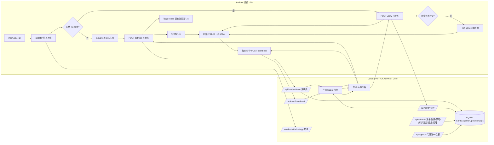

# FY 卡密授权系统 — 设计与部署文档

> 版本: v1.0  
> 日期: 2026-08-22  
> 状态: 实现中  
> 目标: 商业级卡密授权后台（C# + SQLite + Vue3），对标市售发卡系统；Go 设备端脚本接入激活/校验/心跳/续费，防破解。

---

## 目录

- [1. 系统概述](#1-系统概述)
- [2. 功能清单](#2-功能清单)
- [3. 整体架构](#3-整体架构)
- [4. 关键技术决策](#4-关键技术决策)
- [5. 目录结构](#5-目录结构)
- [6. 数据模型](#6-数据模型)
- [7. API 契约](#7-api-契约)
- [8. 设备端签名协议](#8-设备端签名协议)
- [9. 密钥生成](#9-密钥生成)
- [10. 服务器部署](#10-服务器部署)
- [11. 设备端接入](#11-设备端接入)
- [12. 验证清单](#12-验证清单)
- [13. 常见问题](#13-常见问题)

---

## 1. 系统概述

| 项 | 内容 |
|----|------|
| 卡密格式 | `FY-XXXX-XXXX-XXXX`（字符集去 `0/O/1/I`，防输错） |
| 授权模型 | 按"窗口数量"授权（1/3/8），**只限总在线窗口数，不绑设备** |
| 服务器 | ASP.NET Core 8 + SQLite + EF Core（Windows/Linux 云服务器均可） |
| 管理页面 | Vue3 + Element Plus（CDN 本地托管，无 node 构建链） |
| 设备端 | Go 脚本内置 cardkey 包，复用 AutoGo 引擎 API |
| 热更服务 | 由 C# 统一承载（原 Go 版 `cardManager/server` 废弃） |
| 防破解 | RSA 响应签名 + AES-GCM 本地标记 + 窗口限流 + 防爆破锁 |

---

## 2. 功能清单

### 2.1 设备端（手机脚本）

| 功能 | 说明 |
|------|------|
| 首次激活 | 无本地授权 → 弹窗输入卡密 → 服务器激活 → 写加密 .lic |
| 启动校验 | 有授权 → 启动时 POST verify；服务器拒绝（禁用/过期）则提示；断网但有未过期 .lic 则放行（不误杀） |
| 心跳 | 每 10 分钟 POST heartbeat，维持在线窗口；失败重试 3 次、累计 3 轮失败才 HUD 提示，绝不退出 |
| 续费更新 | activate/verify 响应 expire 与本地不同 → 自动更新 .lic（续费即时生效） |
| 到期提醒 | 剩余 ≤3 天 HUD 黄字提示"剩余 X 天，请联系购买方续费"；到期红字提示；不强制退出 |
| 防爆破 | 同一卡号激活失败超 5 次，服务器锁定 10 分钟 |

### 2.2 管理员后台（/admin 页面）

| 功能 | 说明 |
|------|------|
| 登录 | 密码登录，PBKDF2 哈希存储，Cookie 会话 |
| 仪表盘 | 总卡数 / 已激活 / 今日新增激活 / 当前在线窗口数 |
| 发卡 | 数量 + 时长天数 + 窗口数（1/3/8 分段选择）+ 备注；返回批次号 + 卡号列表 |
| 卡密导出 | 一键复制全部 / 下载 txt / 下载 CSV（按批次追溯） |
| 卡密列表 | 搜索卡号、状态筛选（未用/激活/禁用/过期）；行内操作：禁用 / 启用 / 解绑 / 延期 |
| 在线统计 | 每张已激活卡的窗口明细：窗口 ID、设备指纹前几位、最后心跳、在线状态 |
| 操作日志 | 发卡/禁用/启用/解绑/延期/充额度/创建代理/管理员登录全部留痕，可筛选 |
| 代理管理 | 创建代理（用户名+密码+初始额度）、充额度、查看已发卡数与剩余额度 |

### 2.3 代理后台（/agent 页面）

| 功能 | 说明 |
|------|------|
| 登录 | 同一登录入口，自动识别角色跳转 |
| 余额 | 醒目展示剩余可发卡数 |
| 发卡 | 数量/时长/窗口数，从自己额度扣，额度不足提示"余额不足" |
| 名下卡列表 | 只看 Owner 为自己的卡（状态/激活/到期） |

### 2.4 服务器底层

| 机制 | 说明 |
|------|------|
| 卡密生成 | 批量生成不重复卡号，数据库唯一索引兜底 |
| 窗口数量控制 | 内存在线窗口表，在线数 ≥ max_windows 拒绝新窗口；30 分钟无心跳惰性清理 |
| 续费/延期 | 已激活卡再次同卡号激活 = 续费，`ExpireAt = max(now, ExpireAt) + Days*86400`；后台可手动延期 |
| 签名防假 | 所有授权响应带 RSA-SHA256 签名，客户端内置公钥验签 |
| 热更 | `version.txt` / `size` / `app?start=&end=` 分片下载，1:1 复刻原 Go 协议 |

---

## 3. 整体架构



---

## 4. 关键技术决策

1. **跨语言签名契约（成败关键）**
   - 签名串：`code=0|card=FY-XXXX-XXXX-XXXX|expire=1755000000|maxwin=1`
   - C# 侧：`RSA.SignData(bytes, HashAlgorithmName.SHA256, RSASignaturePadding.Pkcs1)`（等价 Go `rsa.SignPKCS1v15`）
   - **公钥必须导出 SubjectPublicKeyInfo 格式 PEM（`BEGIN PUBLIC KEY`）**，Go 端 `x509.ParsePKIXPublicKey` 才能解析；禁止 RSAParameters/XML 格式

2. **响应契约**
   ```json
   {"code":0,"msg":"ok","card":"FY-XXXX-XXXX-XXXX","expire":1755000000,"maxwin":1,"sig":"base64"}
   ```
   - `code=0` 成功且必带 `sig`；`code!=0` 时 `sig` 为空、`msg` 携带原因（卡不存在/已禁用/窗口已满/已锁定/已过期）

3. **续费流程**：任何新生成的卡天然支持续费——已激活卡再次收到同卡号 activate = 续费模式；客户端自动更新本地 .lic

4. **绑定策略（方案 A）**：只限总在线窗口数，不记录绑定设备；8 窗口卡 = 最多 8 个窗口同时在线

5. **断网不误杀**：verify/activate 服务器不可达且有未过期 .lic → 放行；心跳失败只提示不退出

6. **认证与权限**：Cookie 认证 + 角色（admin/agent）；代理只能操作 Owner 为自己的卡

7. **HTTPS**：appsettings 预留 Kestrel 证书配置，未配置时 HTTP + 响应签名兜底

---

## 5. 目录结构

```
cardManager/
├── CardServer/                        # [NEW] C# 后台（ASP.NET Core 8）
│   ├── CardServer.csproj              # net8.0，引用 Microsoft.EntityFrameworkCore.Sqlite
│   ├── Program.cs                     # DI、Cookie 认证、路由、静态文件、HTTPS 重定向（按配置）
│   ├── appsettings.json               # 端口、热更目录、数据库路径、管理员账号、RSA 私钥路径、证书
│   ├── Data/
│   │   ├── AppDbContext.cs            # Cards/Agents/OperationLogs 三表，Code/Username 唯一索引
│   │   └── DbInit.cs                  # EnsureCreated + WAL + 默认管理员种子（PBKDF2）
│   ├── Models/
│   │   ├── Card.cs                    # Code/Days/MaxWindows/Status/ActivateAt/ExpireAt/Owner/Remark/BatchId/FailCount/LockUntil
│   │   ├── Agent.cs                   # Username/PassHash/Salt/Quota/CreatedAt/Parent
│   │   ├── OperationLog.cs            # Id/Time/Actor/Action/Detail
│   │   └── WindowEntry.cs             # WindowID/FP/LastSeen（内存条目）
│   ├── Services/
│   │   ├── KeyGen.cs                  # 卡密生成器 FY-XXXX-XXXX-XXXX（去 0/O/1/I），批量+查重重试
│   │   ├── RsaSigner.cs               # 私钥 PEM 加载、RSA-SHA256 Pkcs1 签名、公钥导出（SPKI PEM）
│   │   ├── WindowTable.cs             # ConcurrentDictionary 窗口表，30 分钟惰性清理
│   │   └── PasswordHasher.cs          # PBKDF2（Rfc2898DeriveBytes）加盐哈希/校验
│   ├── Controllers/
│   │   ├── CardApiController.cs       # activate（含续费）/verify/heartbeat，无认证，签名响应
│   │   ├── AuthController.cs          # 登录（识别 admin/agent）、登出、当前用户
│   │   ├── AdminController.cs         # 发卡/列表/禁用/启用/解绑/延期/日志/代理管理（admin 角色）
│   │   └── AgentController.cs         # 余额/额度内发卡/名下卡（agent 角色，事务扣 Quota）
│   ├── HotUpdate/
│   │   └── HotUpdateEndpoints.cs      # /version.txt /size /app?start=&end= 分片（白名单+越界截断）
│   └── wwwroot/                       # Vue3 + Element Plus 本地托管
│       ├── login.html                 # 登录页（玻璃拟态 + 蓝紫渐变）
│       ├── admin.html                 # 仪表盘/发卡(导出)/卡密列表/在线统计/操作日志/代理管理
│       └── agent.html                 # 余额/发卡/名下卡列表
├── cardkey/                           # [NEW] Go 客户端授权包
│   ├── cardkey.go                     # CheckAndActivate + StartHeartbeat；InputAlert 激活；断网容忍；到期提醒
│   ├── crypto.go                      # RSA 公钥验签；AES-GCM 加解密（密钥=SHA256(设备指纹+盐)）
│   ├── deviceid.go                    # 设备指纹：AndroidId+Serial+Model+Brand → SHA-256 hex
│   └── license.go                     # .lic 读写（复用 updater.executablePath() 同目录）
├── server/                            # [废弃] Go 版热更服务器，保留作参考不删除
main.go                                # [MODIFY] CheckAndUpdate 后接入 cardkey.CheckAndActivate；b.Run 前启动 StartHeartbeat
assets/default.json                    # [MODIFY] 新增 license_pubkey、license_server
```

---

## 6. 数据模型

### 6.1 Card（卡密）

| 字段 | 类型 | 说明 |
|------|------|------|
| Id | int | 主键 |
| Code | string | 卡号 `FY-XXXX-XXXX-XXXX`（唯一索引） |
| Days | int | 有效天数（30/60/90…） |
| MaxWindows | int | 窗口数 1/3/8 |
| Status | string | `unused` / `active` / `disabled` |
| ActivateAt | long | 首次激活时间（Unix 秒） |
| ExpireAt | long | 到期时间（Unix 秒）；续费时 `max(now, ExpireAt) + Days*86400` |
| Owner | string | 发卡者，管理员为 `"admin"`，代理为用户名 |
| Remark | string | 备注 |
| BatchId | string | 发卡批次 UUID（导出追溯） |
| FailCount | int | 连续激活失败次数（防爆破） |
| LockUntil | long | 锁定截止（Unix 秒） |

### 6.2 Agent（代理）

| 字段 | 类型 | 说明 |
|------|------|------|
| Id | int | 主键 |
| Username | string | 用户名（唯一索引） |
| PassHash | string | PBKDF2 哈希（Base64） |
| Salt | string | 随机盐（Base64） |
| Quota | int | 剩余可发卡数 |
| CreatedAt | long | 创建时间（Unix 秒） |
| Parent | string | 上级（预留二级分销，当前恒为 "admin"） |

### 6.3 OperationLog（操作日志）

| 字段 | 类型 | 说明 |
|------|------|------|
| Id | int | 主键 |
| Time | long | 操作时间（Unix 秒） |
| Actor | string | 操作者（用户名/角色） |
| Action | string | 动作（发卡/禁用/启用/解绑/延期/充额度/创建代理/登录…） |
| Detail | string | 详情（JSON 或文本） |

### 6.4 WindowEntry（内存在线窗口，不落库）

| 字段 | 说明 |
|------|------|
| WindowID | 窗口 ID（设备每次启动随机生成） |
| FP | 设备指纹（前几位用于展示） |
| LastSeen | 最后心跳时间（Unix 秒） |

---

## 7. API 契约

### 7.1 设备端（无认证）

| 方法 | 路径 | 请求 | 响应 | 说明 |
|------|------|------|------|------|
| POST | `/api/card/activate` | `{"code":"FY-...","fp":"设备指纹","window_id":"随机ID"}` | 签名响应 | 激活；已激活卡 = 续费 |
| POST | `/api/card/verify` | `{"code":"FY-...","fp":"设备指纹","window_id":"随机ID"}` | 签名响应 | 启动校验 |
| POST | `/api/card/heartbeat` | `{"code":"FY-...","window_id":"随机ID"}` | `{"code":0,"msg":"ok"}` | 心跳，刷新窗口在线时间 |

签名响应格式（见第 8 节）。

### 7.2 认证（管理端）

| 方法 | 路径 | 请求 | 响应 | 说明 |
|------|------|------|------|------|
| POST | `/api/auth/login` | `{"username":"...","password":"..."}` | `{"role":"admin"\|"agent"}` | 登录，Set-Cookie |
| POST | `/api/auth/logout` | - | `{"code":0}` | 登出 |
| GET | `/api/auth/me` | - | `{"username":"...","role":"..."}` | 当前登录用户（401 未登录） |

### 7.3 管理员 API（需 admin 角色）

| 方法 | 路径 | 说明 |
|------|------|------|
| GET | `/api/admin/stats` | 仪表盘统计：总卡/已激活/今日新增/在线窗口 |
| POST | `/api/admin/generate` | 发卡 `{"count":50,"days":30,"max_windows":3,"remark":"..."}` → `{"batch_id":"...","cards":["FY-...",...]}` |
| GET | `/api/admin/cards` | 卡列表 `?search=&status=&owner=&page=&page_size=` |
| POST | `/api/admin/cards/disable` | 禁用 `{"code":"FY-..."}` |
| POST | `/api/admin/cards/enable` | 启用 `{"code":"FY-..."}` |
| POST | `/api/admin/cards/unbind` | 解绑（重置为未使用）`{"code":"FY-..."}` |
| POST | `/api/admin/cards/renew` | 手动延期 `{"code":"FY-...","days":30}` |
| GET | `/api/admin/windows` | 在线窗口统计（按卡分组明细） |
| GET | `/api/admin/logs` | 操作日志 `?actor=&action=&page=&page_size=` |
| GET | `/api/admin/agents` | 代理列表（含已发卡数/剩余额度） |
| POST | `/api/admin/agents/create` | 创建代理 `{"username":"...","password":"...","quota":100}` |
| POST | `/api/admin/agents/recharge` | 充额度 `{"username":"...","quota":100}` |

### 7.4 代理 API（需 agent 角色）

| 方法 | 路径 | 说明 |
|------|------|------|
| GET | `/api/agent/me` | 当前代理信息（用户名/剩余额度/已发卡数） |
| POST | `/api/agent/generate` | 发卡（扣额度，事务）`{"count":50,"days":30,"max_windows":3}` |
| GET | `/api/agent/cards` | 名下卡列表 `?search=&status=&page=&page_size=` |

---

## 8. 设备端签名协议

```
签名原文（竖线分隔，无空格）:
  code=0|card=FY-XXXX-XXXX-XXXX|expire=1755000000|maxwin=1

签名算法:
  C#:  RSA.SignData(UTF8(bytes), SHA256, RSASignaturePadding.Pkcs1)
  Go:  rsa.SignPKCS1v15(rand, privKey, crypto.SHA256, sha256(bytes))

响应 JSON:
  {
    "code": 0,                       // 0=成功
    "msg": "ok",
    "card": "FY-XXXX-XXXX-XXXX",
    "expire": 1755000000,            // Unix 秒
    "maxwin": 1,
    "sig": "base64(RSA签名)"          // 成功时必带；失败时为空字符串
  }

公钥格式（C# 导出，Go 解析）:
  C#:  rsa.ExportSubjectPublicKeyInfoPem()   → "-----BEGIN PUBLIC KEY-----\n..."
  Go:  x509.ParsePKIXPublicKey(pemBlock.Bytes) → *rsa.PublicKey
```

**验签失败即视为假服务器**：客户端拒绝该响应，按"服务器不可达"处理（本地 .lic 未过期则放行）。

---

## 9. 密钥生成

在部署服务器上执行（需安装 OpenSSL）：

```bash
# 1. 生成 RSA 私钥（2048 位）
openssl genpkey -algorithm RSA -out private.pem -pkeyopt rsa_keygen_bits:2048

# 2. 导出公钥（SubjectPublicKeyInfo 格式，Go 端可解析）
openssl pkey -in private.pem -pubout -out public.pem
```

- `private.pem` **只放服务器**，放入 appsettings 指定路径（默认 CardServer 运行目录下 `private.pem`）
- `public.pem` 内容填入 `assets/default.json` 的 `license_pubkey` 字段，随 Go 二进制分发（go:embed 嵌入，改公钥需重编译属预期）

生成后可用以下命令验证格式：

```bash
openssl pkey -in public.pem -pubin -text -noout   # 应显示 RSA Public-Key
```

---

## 10. 服务器部署

### 10.1 编译发布

需要 .NET 8 SDK：

```bash
cd e:\autogo\FY\cardManager\CardServer

# Windows 自包含单文件
dotnet publish -c Release -r win-x64 --self-contained true -p:PublishSingleFile=true -o publish

# Linux x64（云服务器）
dotnet publish -c Release -r linux-x64 --self-contained true -p:PublishSingleFile=true -o publish
```

### 10.2 目录规划

```
/opt/cardserver/
├── CardServer                # 编译产物（或 CardServer.exe）
├── appsettings.json          # 配置（端口/热更目录/数据库/私钥）
├── private.pem               # RSA 私钥（只放服务器）
├── cards.db                  # SQLite 数据库（首次启动自动创建）
└── hotupdate/                # 热更目录
    ├── version.txt           # 纯文本版本号，如 "2.5"
    └── app                   # 新版 Go 可执行文件（与客户端热更协议匹配）
```

### 10.3 appsettings.json

```json
{
  "Urls": "http://0.0.0.0:8080",
  "CardServer": {
    "HotUpdateDir": "hotupdate",
    "DbPath": "cards.db",
    "RsaPrivateKeyPath": "private.pem",
    "AdminUsername": "admin",
    "AdminPassword": "改我啊",
    "Token": ""
  },
  "Kestrel": {
    "Certificates": {
      "Default": {
        "Path": "",
        "Password": ""
      }
    }
  }
}
```

- `HotUpdateDir`：热更文件目录（version.txt / app）
- `AdminPassword`：首次启动创建管理员，之后修改需清空数据库或手动改库
- `Token`：可选，为空时管理接口仅依赖登录态
- Kestrel 证书配置后自动启用 HTTPS（有域名证书时再配）

### 10.4 启动

```bash
# Linux
chmod +x CardServer
nohup ./CardServer > server.log 2>&1 &

# Windows
CardServer.exe
```

启动成功日志：

```
[CardServer] 卡密系统已启动
[CardServer] 热更目录: /opt/cardserver/hotupdate
[CardServer] 数据库: /opt/cardserver/cards.db
[CardServer] RSA 私钥: /opt/cardserver/private.pem
[CardServer] 监听: http://0.0.0.0:8080
```

### 10.5 防火墙

- 放行 TCP 端口 8080（或自定义端口）

---

## 11. 设备端接入

### 11.1 assets/default.json 新增

```json
{
  "version": "2.5",
  "update_url": "http://111.231.167.150:8080/",
  "license_server": "http://111.231.167.150:8080/",
  "license_pubkey": "-----BEGIN PUBLIC KEY-----\nMIIBIjANBgkqhkiG9w0BAQEFAAOCAQ8AMIIBCgKCAQEA...\n-----END PUBLIC KEY-----\n"
}
```

- `license_server`：卡密服务器地址（默认复用 update_url）
- `license_pubkey`：RSA 公钥 PEM（第 9 节生成的 public.pem 内容）

### 11.2 main.go 接入

```go
// 热更检查后、InitHUD 前
if updater.CheckAndUpdate(core.Config.GetString("update_url")) {
    return
}
cardkey.CheckAndActivate(core.Config.GetString("license_server"))

// 创建 Bot 后、b.Run() 前
go cardkey.StartHeartbeat(core.Config.GetString("license_server"))
```

### 11.3 设备端流程

```
启动 → 热更检查 → 卡密激活/校验（弹窗 or 静默）→ InitHUD → Bot 启动 → 心跳 goroutine
```

### 11.4 .lic 文件

- 位置：可执行文件同目录（`app.lic`，与 updater 的 `app.ver` 相邻）
- 内容：卡号、到期时间、max_windows、设备指纹 hash（AES-GCM 加密，密钥 = SHA256(设备指纹 + 固定盐)）
- 换设备/换指纹 → 解密失败 → 自动重新激活

---

## 12. 验证清单

### 12.1 服务器自测（curl）

```bash
# 登录管理员
curl -c cookies.txt -X POST http://127.0.0.1:8080/api/auth/login \
  -H "Content-Type: application/json" \
  -d '{"username":"admin","password":"改我啊"}'

# 发卡 5 张（30 天，3 窗口）
curl -b cookies.txt -X POST http://127.0.0.1:8080/api/admin/generate \
  -H "Content-Type: application/json" \
  -d '{"count":5,"days":30,"max_windows":3,"remark":"测试"}'

# 设备激活
curl -X POST http://127.0.0.1:8080/api/card/activate \
  -H "Content-Type: application/json" \
  -d '{"code":"FY-XXXX-XXXX-XXXX","fp":"testfp001","window_id":"w1"}'
```

### 12.2 发卡 → 激活 → 多窗口压测

1. 管理员登录 → 发卡页生成 5 张（30 天 3 窗口）
2. 复制 1 张 → 用 curl 模拟 3 个设备激活（不同 fp/window_id）→ 应全部成功
3. 第 4 个设备激活 → 应返回 `"窗口已满"`（code != 0）
4. 断开 1 个窗口（30 分钟不心跳）→ 再激活 → 应成功（窗口表清理）

### 12.3 续费验证

1. 已激活卡再次用同卡号 activate（不同 window_id）→ 应返回续费后的新 expire（原到期日 + 30 天）
2. 设备端 verify 返回新 expire → .lic 自动更新 → HUD 显示新剩余天数

### 12.4 防爆破验证

1. 同一卡号连续输错 6 次 → 第 6 次起返回"已锁定，10 分钟后再试"
2. 10 分钟后 → 恢复正常

### 12.5 断网容错验证

1. 已激活设备断网启动 → 本地 .lic 未过期 → 正常放行进入脚本
2. 断网时心跳失败 → 仅 HUD 提示，不退出
3. 到期后断网启动 → .lic 过期 → 提示到期，不退出（挂机优先）

### 12.6 到期提醒验证

1. 发一张 3 天卡激活 → HUD 显示"剩余 3 天，请联系购买方续费"（黄字）
2. 到期后启动 → HUD 红字"卡密已过期"

### 12.7 导出验证

1. 发卡成功 → 页面出现卡号列表 → "一键复制全部" → 粘贴到记事本验证
2. "下载 txt" / "下载 CSV" → 文件内容与批次一致

### 12.8 代理分销验证

1. 管理员创建代理 `agent1`（额度 100）
2. agent1 登录 → 余额显示 100 → 发 10 张卡 → 余额 90
3. agent1 名下卡列表只显示自己的 10 张
4. 管理员给 agent1 充 50 → 余额 140
5. agent1 发卡额度不足（余额 0 时）→ 提示"余额不足"

### 12.9 热更验证

1. hotupdate 目录放 version.txt（如 "2.6"）+ app
2. 设备启动 → 检查到新版本 → 分片下载 → 覆盖自身重启 → 启动后版本 2.6
3. `GET /size` 返回 app 字节数；`GET /app?start=0&end=1048576` 返回分片

---

## 13. 常见问题

**Q1: 客户端提示"服务器响应签名无效"？**
- 检查 public.pem 是否与服务器 private.pem 配对（第 9 节重新生成一对）
- 检查 public.pem 是否 BEGIN PUBLIC KEY 格式（不能是 BEGIN RSA PUBLIC KEY）

**Q2: Go 端解析公钥报错？**
- C# 导出用 `ExportSubjectPublicKeyInfoPem()`（SPKI 格式）；若用了 `ExportRSAPublicKeyPem()`（PKCS#1）Go 端 x509.ParsePKIXPublicKey 会失败，需改用 x509.ParsePKCS1PublicKey

**Q3: 修改了 default.json 但设备还是旧配置？**
- default.json 是 go:embed 嵌入，必须重新编译 Go 脚本才生效

**Q4: 忘了管理员密码？**
- 删除 cards.db 重新启动（会重新种子管理员）；或手动改库

**Q5: 想开 HTTPS？**
- appsettings.json 的 Kestrel.Certificates 配置证书路径与密码，重启即可；设备端需信任该证书（公网建议用正式域名证书）

**Q6: 热更 app 与 version.txt 放哪？**
- appsettings 的 HotUpdateDir 目录（默认运行目录下 hotupdate/）

---

## 附录：实现步骤（当前进度）

- [x] 需求确认与技术选型
- [x] 本文档
- [x] CardServer 骨架 + 数据模型 + 卡密生成器
- [x] RSA 签名 + activate/verify/heartbeat + 在线窗口表
- [x] 登录 + 管理员/代理 API + 操作日志
- [x] 热更端点 + Program.cs 组装
- [x] wwwroot 三页前端（登录/管理员/代理）
- [x] Go cardkey 包（deviceid/crypto/license/cardkey）
- [x] 接入 main.go + default.json + 部署/压测

## 附录：default.json 卡密配置说明

`license_server`：卡密服务器地址（默认复用 update_url）。  
`license_pubkey`：服务器 RSA 公钥 PEM（第 9 节生成的 public.pem 内容，`-----BEGIN PUBLIC KEY-----` 整段粘贴为一行，换行用 `\n` 转义）。**此字段必填**，为空时设备端验签失败、首次激活会失败；改公钥需重新编译 Go 脚本（go:embed 嵌入）。
