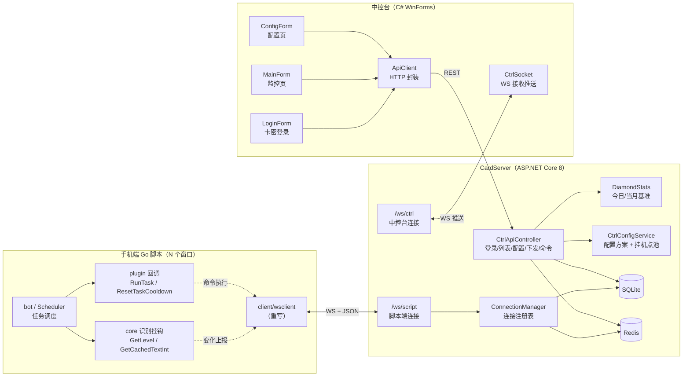
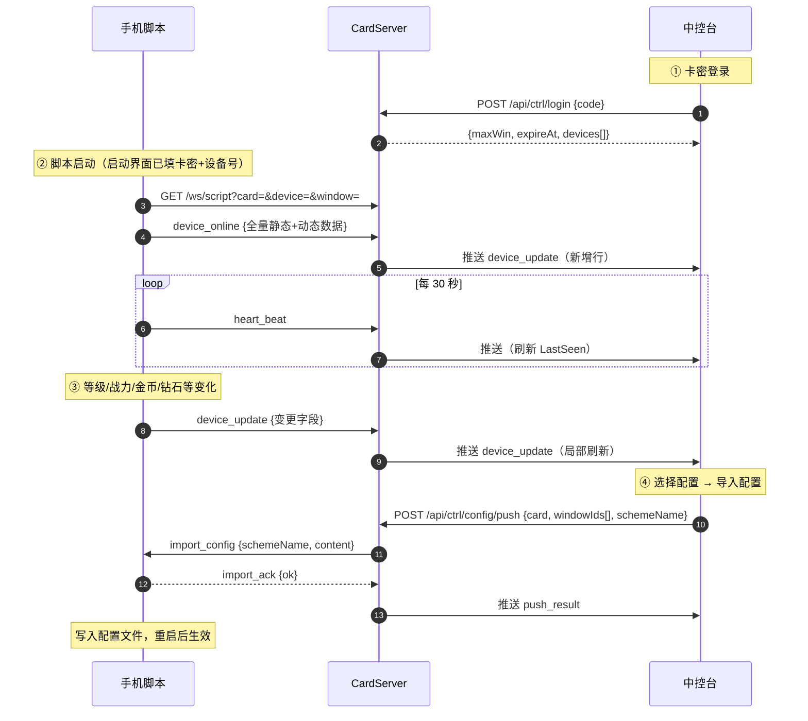
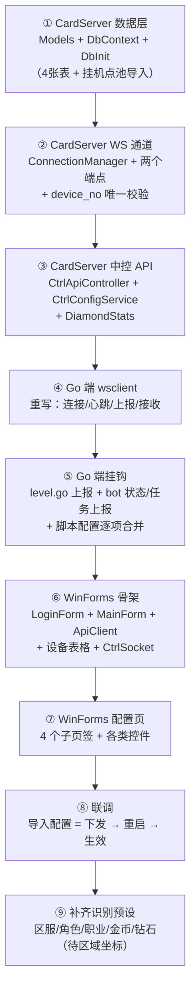

# 中控系统方案（远程群控 / 设备监控 + 配置下发）

> 本文档是 **e:/autogo/ql** 项目远程中控系统的完整设计与实施说明。
> 所有条目均已与需求方逐条确认，不含待定项；未确认的内容会明确标注「待补」。
>
> 状态：**设计定稿（仅文档，未实现）**
> 编写日期：2026-09-26
> 涉及项目：Go 手机脚本（本仓库）+ C# CardServer（本仓库）+ C# WinForms 中控台（新建）

---

## 目录

1. [产品概述](#1-产品概述)
2. [明确不做的事](#2-明确不做的事)
3. [总体架构](#3-总体架构)
4. [角色与组件职责](#4-角色与组件职责)
5. [通信协议（完整字段表）](#5-通信协议完整字段表)
6. [数据上报机制](#6-数据上报机制)
7. [今日/当月钻石算法](#7-今日当月钻石算法)
8. [中控台界面设计](#8-中控台界面设计)
9. [监控页：完整控件与列明细](#9-监控页完整控件与列明细)
10. [配置页：完整控件明细](#10-配置页完整控件明细)
11. [配置存储与下发](#11-配置存储与下发)
12. [中控登录与可见范围](#12-中控登录与可见范围)
13. [CardServer 改动清单](#13-cardserver-改动清单)
14. [中控台 WinForms 工程结构](#14-中控台-winforms-工程结构)
15. [Go 端改动清单](#15-go-端改动清单)
16. [数据库表结构](#16-数据库表结构)
17. [界面视觉规范](#17-界面视觉规范)
18. [实施顺序](#18-实施顺序)
19. [风险与注意事项](#19-风险与注意事项)
20. [附录：需求确认清单](#20-附录需求确认清单)

---

## 1. 产品概述

为手游自动化脚本（Go，`e:/autogo/ql`）新增一套 **远程中控系统**：

- **服务端**：直接加在项目现有 `cardManager/CardServer`（C# ASP.NET Core 8，已具备 SQLite + Redis + Cookie 认证 + 卡密体系）上，新增 **WebSocket 通道** 与 **中控 HTTP API**。
- **中控台**：新建 **C# WinForms 桌面程序**，放 `ql/control/`，提供「监控」与「配置」两个核心页签。
- **手机端**：沿用现有 Go 脚本（`bot` / `task` / `core` / `plugin` 架构），新增 WS 客户端负责上报与接收指令。

核心价值：

1. 一张表看清所有脚本窗口的在线状态、角色数据、当前任务、生效配置。
2. 图形化配置表单，一份配置可批量下发给多台设备（逐项合并，不影响内置默认）。
3. 复用现有卡密体系做登录与数据隔离，不引入第二套账号系统。

---

## 1.1 前置：本次会话已完成的相关改动（勿重复实现）

以下改动已落地，是本次中控开发的基础，实现中控时**直接复用、不要重做**：

| 文件 | 已完成的改动 |
|---|---|
| `ui/uishow.go` | `UIConfig` 精简为 `KaMi` / `SheBeiHao`（**拼音字段名**，因中文字段名不被 Go 导出、JSON 会静默丢弃）；标签栏只保留「卡密」页，其余页面整体块注释保留 |
| `ui/uiPlugin.go` | `UI_运行脚本` 增加卡密非空校验 + 同步联网校验（`cardkey.VerifyCard`），失败**不关界面**、界面内红字提示；新增 `UI_停止倒计时` / `UI_RunCountdownPaused` / `UI_RunCountdownFrozen`；按钮布局：运行脚本 280 / 退出脚本 200 / 加时 70 / 停止 70 |
| `cardManager/cardkey/cardkey.go` | 移除 `InputAlert` 弹窗（原 `forceInputLoop` 已注释）；新增 `activateWithCard` / `VerifyCard` / `SetDeviceNo` / `DeviceNo`；`CheckAndActivate(serverURL, card)`；`activate` 请求体携带 `device_no` |
| `main.go` | UI 面板位于 `else`（非 dev）分支内；读取 `ui.RunConfig.KaMi` / `SheBeiHao` 传入 `cardkey.SetDeviceNo` |
| `core/hud_status.go` | `updateHUD` 坐标已恢复原值（竖屏 `[138,783,505,974]`）|

**已踩过的坑（务必遵守）**：

1. **imgui 按钮回调里不能调用引擎原生 API**（`utils.Toast` / `core.SetUpdateLogsColor`）→ 会 **SIGILL 崩溃**。UI 内提示只能用 imgui 自己的绘制。
2. **`UI_设置文本` 的宽高参数传 `0,0` 会 SIGILL**，必须传正常尺寸（如 `120, 45`）。
3. **Go 结构体字段名首字符为中文不会被 JSON 序列化**，必须用拼音/英文字段名 + `json:"中文"` tag。

---

## 2. 明确不做的事

以下内容经需求方逐条确认 **不做**，实现时不得擅自加入：

| # | 不做项 | 说明 |
|---|---|---|
| 1 | **截图 / 投屏** | 不采集、不上传、不显示任何屏幕图像 |
| 2 | **远程点击 / 滑动 / 输入** | 无任何远控设备操作能力 |
| 3 | **Web 网页版中控** | 中控台是 WinForms 桌面程序，不跑 Kestrel 前端页面（仅 CardServer 现有 wwwroot 静态页保持原样） |
| 4 | **发卡人归属（Owner）视图** | 中控不看「谁是发卡人」，只看卡密自身的窗口 |
| 5 | 「重置每日」按钮 | 参考图里有，但不做 |
| 6 | 「启动 / 暂停 / 恢复」按钮 | 参考图里没有；虽然 ql 具备这些能力，但确认不加 |
| 7 | 时装 / 翅膀 / 坐骑 / 宝石 / 勋章 / 账号密码 列 | ql 无对应数据 |
| 8 | 今日产出 / 当月产出 / 用户类型 / 登录账号（顶部统计） | 不做 |
| 9 | 挂机点「切换次数」显示 | 参考列里有，但中控不显示 |
| 10 | 挂机点「加地图 / 删地图 / 加挂机点 / 删挂机点」按钮 | 不做，中控只从固定的挂机点池里选 1 个 |
| 11 | 「境界配置」显示 | 中控**完全不显示**，保留手机内置值 |
| 12 | 背包页签「识别引用」字段 | 中控隐藏该字段 |

---

## 3. 总体架构



### 数据流总览



---

## 4. 角色与组件职责

### 4.1 手机端（Go）

| 组件 | 职责 |
|---|---|
| `client/wsclient.go`（重写） | WS 连接、注册、30s 心跳、上报、接收 `import_config` / 命令、断线重连 |
| `core/level.go` | `GetLevel` / `GetCachedTextInt` 识别成功分支挂「变化上报」 |
| `bot/` | 状态变化（Running/Paused/Stopped）、任务完成/失败、任务开始 → 上报 |
| `plugin` | 已有回调注入模式（`SetRunTaskFunc` 等），中控命令复用这套注入通道 |
| `cardManager/cardkey` | 提供卡密、设备号、窗口ID 给 wsclient 使用 |

### 4.2 服务端（CardServer）

| 组件 | 职责 |
|---|---|
| `WebSocket/ScriptSocketEndpoint` | `/ws/script`：接收脚本连接与上报，下发配置与命令 |
| `WebSocket/CtrlSocketEndpoint` | `/ws/ctrl`：中控台订阅实时推送 |
| `Services/ConnectionManager` | 在线连接注册表（脚本 + 中控），广播推送 |
| `Services/CtrlConfigService` | 配置方案 CRUD、逐项合并、挂机点池读取 |
| `Services/DiamondStats` | 今日/当月钻石基准维护与定时重置 |
| `Controllers/CtrlApiController` | 中控台 REST：登录、设备列表、配置、下发、命令转发 |
| `Services/WindowTable`（现有） | 复用：在线窗口判定；**扩展** `WindowEntry` 增加 `DeviceNo` |

### 4.3 中控台（WinForms）

| 组件 | 职责 |
|---|---|
| `LoginForm` | 卡密输入 → `/api/ctrl/login` → 进入主窗体 |
| `MainForm` | TabControl（监控/配置/产出明细*/更新日志*/使用说明*）、工具栏、设备表格、状态栏 |
| `ConfigForm` | 图形化配置表单（子页签 + 分组框 + 各类控件） |
| `Controls/DeviceGridView` | `VirtualMode` 设备表格，支持大量行 |
| `Services/ApiClient` | HTTP 封装（登录、列表、配置、下发、命令） |
| `Services/CtrlSocket` | 连接 `/ws/ctrl`，接收推送并触发局部刷新 |

> `*` = 先做页签占位，内容留空。

---

## 5. 通信协议（完整字段表）

### 5.1 传输约定

| 项 | 约定 |
|---|---|
| 传输层 | WebSocket 长连接 |
| 编码 | UTF-8 文本帧，JSON |
| 顶层结构 | `{ "type": string, "params": object }` |
| 字段命名 | **camelCase**（与服务端现有 `JsonNamingPolicy.CamelCase` 一致） |
| 心跳间隔 | **30 秒**（`heart_beat`） |
| 离线判定 | **90 秒** 无任何上行消息，或连接断开 |
| 重连策略 | 指数退避 1s → 2s → 4s → … 最大 30s，连接成功重置 |

### 5.2 端点

| 端点 | 使用者 | 说明 |
|---|---|---|
| `GET /ws/script?card=..&device=..&window=..` | 手机脚本 | 连接即注册；服务端校验卡密有效后接受 |
| `GET /ws/ctrl?card=..` | 中控台 | 连接即订阅该卡所有设备的推送 |

### 5.3 上行（手机 → 服务端）

#### ① `device_online` — 上线全量

| 字段 | 类型 | 必填 | 说明 | 来源 |
|---|---|---|---|---|
| `card` | string | ✅ | 卡密号 | `cardkey.LoadLicense().Card` |
| `deviceNo` | string | ✅ | 设备号（用户填，**同卡内唯一 = 设备身份**） | 启动界面 `ui.RunConfig.SheBeiHao` |
| `windowId` | string | ✅ | 窗口 ID（每次启动随机，仅作连接标识） | `cardkey` 内部 `windowID` |
| `server` | string | ⛔ | 区服 | `core.Exec("区服")`（预设**待补**）|
| `role` | string | ⛔ | 角色名 | `core.Exec("角色")`（预设**待补**）|
| `job` | string | ⛔ | 职业 | `core.Exec("职业")`（预设**待补**）|
| `level` | int | ⛔ | 等级 | `core.GetLevel()` |
| `power` | int | ⛔ | 战力 | `core.GetCachedTextInt("战斗力")` |
| `gold` | int | ⛔ | 金币 | 预设**待补** |
| `diamond` | int | ⛔ | 钻石 | 预设**待补** |
| `bagFree` | string | ⛔ | 背包剩余（如 `12/45`）| 取文"背包数量" |
| `state` | string | ✅ | `running` / `paused` / `stopped` | `bot.StateMachine.Get()` |
| `task` | string | ⛔ | 当前任务名 | `bot.Scheduler` |
| `schemeName` | string | ⛔ | 当前生效配置名 | 本地记录 |

> 标记 `⛔` 的字段：**识别预设当前不存在**，字段先预留，值为空时不报（见 §15.4）。

#### ② `heart_beat` — 心跳

| 字段 | 类型 | 说明 |
|---|---|---|
| （无） | — | 仅表示存活，不带业务数据 |

#### ③ `device_update` — 变化上报

只带**发生变化的字段**，字段名同 `device_online`。

| 字段 | 触发时机 |
|---|---|
| `level` | `GetLevel` / `GetCachedTextInt("等级")` 识别成功且与上次不同 |
| `power` | `GetCachedTextInt("战斗力")` 识别成功且与上次不同 |
| `gold` / `diamond` / `bagFree` | 同上（预设就绪后）|
| `state` | `bot.StateMachine` 状态迁移时立即上报 |
| `task` | 调度器开始/结束任务时上报 |

#### ④ `log` — 日志（可选，默认关）

| 字段 | 类型 | 说明 |
|---|---|---|
| `level` | string | `info` / `warn` / `error` |
| `message` | string | 日志内容 |

#### ⑤ `import_ack` — 配置接收回执

| 字段 | 类型 | 说明 |
|---|---|---|
| `schemeName` | string | 收到的配置名 |
| `ok` | bool | 是否成功写入 |
| `msg` | string | 失败原因（成功为空）|

### 5.4 下行（服务端 → 手机）

#### ① `welcome`

| 字段 | 类型 | 说明 |
|---|---|---|
| `serverTime` | long | 服务器 Unix 秒 |
| `heartbeatSec` | int | 期望心跳间隔（30）|

#### ② `import_config` — 下发配置

| 字段 | 类型 | 说明 |
|---|---|---|
| `schemeName` | string | 配置方案名 |
| `content` | object | 配置内容（**逐项合并用**，只含中控可编辑项）|

`content` 结构（对应 §10 表单）：

```json
{
  "装备强化数量上限": { "值": 10 },
  "自动分解配置":     { "值": ["一般", "高级"] },
  "扩展背包配置":     { "值": 100 },
  "优先挂机点":       { "值": ["迷雾村1"] },
  "挂机点表":         { "值": [ { "地图名": "迷雾村", "切换识别引用": "切换",
                                "挂机点列表": [ { "挂机点名": "迷雾村1",
                                                "等级门槛": 30, "战力门槛": 90000,
                                                "切换次数": 0 } ] } ] },
  "背包页签名单":     { "值": [ /* 完整页签数组，结构见 §10.5 */ ] }
}
```

#### ③ 控制类命令

| type | params | 对应 ql 动作 |
|---|---|---|
| `cmd_stop` | `{}` | `bot.Stop()` |
| `cmd_restart` | `{}` | 全量重启（`plugin.TriggerFullRestart`）|
| `cmd_reset_cooldown` | `{ "task": "野外挂机" }` | `plugin.ResetTaskCooldown(task)`；`task` 为空表示全部任务 |
| `cmd_refresh` | `{}` | 重新读一次静态字段并上报 |

#### ④ `kick`

| 字段 | 类型 | 说明 |
|---|---|---|
| `reason` | string | 踢下线原因（卡密失效/被禁用等）|

### 5.5 中控台 REST API

| 方法 | 路径 | 说明 |
|---|---|---|
| POST | `/api/ctrl/login` | 卡密登录：`{code}` → `{code,msg,maxWin,expireAt,cardStatus,devices[]}` |
| GET | `/api/ctrl/devices` | 该卡全部设备（含离线）|
| POST | `/api/ctrl/config/save` | 保存配置方案 |
| GET | `/api/ctrl/config/list` | 配置方案列表（该卡）|
| GET | `/api/ctrl/config/get?scheme=` | 读取单个方案 |
| DELETE | `/api/ctrl/config/delete?scheme=` | 删除方案 |
| POST | `/api/ctrl/config/push` | 下发：`{card,windowIds[],schemeName}` |
| GET | `/api/ctrl/hangpoints` | 挂机点池（下拉选项源）|
| POST | `/api/ctrl/cmd` | 命令：`{card,windowIds[],type,params}` |
| POST | `/api/ctrl/remove` | 移除设备行：`{card,windowIds[]}` |

---

## 6. 数据上报机制

### 6.1 上报时机总表

| 时机 | 消息 | 频次 | 说明 |
|---|---|---|---|
| 连接建立后 | `device_online` | 一次 | 全量数据一次性上报 |
| 保活 | `heart_beat` | **每 30 秒** | 只报存活，不报数据 |
| 等级变化 | `device_update` | 变化即报 | 挂在 `GetLevel`/`GetCachedTextInt` 成功分支 |
| 战力变化 | `device_update` | 变化即报 | 同上 |
| 金币/钻石/背包变化 | `device_update` | 变化即报 | 预设就绪后启用 |
| 状态变化 | `device_update` | 变化即报 | `StateMachine` 订阅回调 |
| 任务变化 | `device_update` | 变化即报 | `Scheduler` 开始/完成回调 |
| 角色/职业/区服 | 仅上线报一次 | 一次 | 登录完成后（主界面）读取；跑任务时界面不在主界面读不到 |
| 日志 | `log` | 可选（默认关） | 避免刷屏 |

### 6.2 关键设计：为什么不做「定时全量上报」

等级 / 战力 / 金币 / 钻石这些值 **只在特定界面（主界面 HUD）才能识别到**。
跑任务时界面在其他场景，`core.Exec("等级")` 会识别失败。

因此：

- **不做**定时轮询上报（会大面积上报失败/上报 0）；
- **改为**挂在程序**本来就会读这些值的地方**（`GetLevel` / `GetCachedTextInt` 成功分支），
  读到且与「上次上报值」不同才上报 → **零额外开销、无失败上报、不浪费流量**。

### 6.3 上报值缓存（去重）

手机端维护一份「上次上报快照」：

```go
type reportedSnapshot struct {
    Level  int
    Power  int
    Gold   int
    Diamond int
    State  string
    Task   string
}
```

比对规则：字段变化才进入 `device_update` 的 params；全部无变化则不发消息。

### 6.4 离线判定与展示

| 项 | 规则 |
|---|---|
| 服务端判定离线 | 90 秒无任何上行消息（含心跳）或连接断开 |
| 中控台展示 | **离线设备保留该行不删除**，整行置灰，状态显示 ⚫ 离线 |
| 设备重新上线 | 同 `card + deviceNo` → 原地更新（`windowId` 只刷新为最新连接）；同一台设备重启脚本不会多出新行 |

---

## 7. 今日/当月钻石算法

### 7.1 背景

游戏界面里**只有「当前钻石总量」**，没有「今日钻石」「当月钻石」文字。
因此这两个值由 **服务端统计计算**。

### 7.2 算法（A：净增）

```
今日钻石(w) = max(0, 当前钻石(w) - todayBase(w))
当月钻石(w) = max(0, 当前钻石(w) - monthBase(w))
```

`w` = 窗口 ID（**每台设备各自一份基准**）。

### 7.3 基准维护

| 事件 | 动作 |
|---|---|
| 设备首次上报钻石（该窗口无基准记录） | `todayBase = monthBase = 当前钻石` |
| 每天 00:00:00 | 所有设备的 `todayBase = 当前钻石` |
| 每月 1 号 00:00:00 | 所有设备的 `monthBase = 当前钻石` |
| 计算得负（玩家花掉钻石） | 显示 **0** |

### 7.4 定时重置实现

- 服务端 `DiamondStats` 使用 `System.Threading.Timer` / 后台 `IHostedService`；
- 每日 00:00、每月 1 号 00:00 触发：
  - 遍历在线设备：用其最后一次上报的 `diamond` 更新基准；
  - 离线设备：基准保持不变（下次上线时若超过一个自然日则重置，见下）；
- **离线跨天补正**：设备上线时，若 `todayBaseDate != 今天`，则 `todayBase = 当前钻石`（避免离线多天后今日值虚高）。

### 7.5 存储字段

见 §16 `DiamondBase` 表：`WindowId / CardCode / TodayBase / MonthBase / TodayDate / MonthKey / UpdatedAt`。

---

## 8. 中控台界面设计

### 8.1 主窗体结构

```
┌════════════════════════════════════════════════════════════════════════════┐
║  AutoGo 中控台                              ● 服务端通信正常   卡密: FY-XXXX-… ║
╠════════════════════════════════════════════════════════════════════════════╣
║  [ 监控 ] [ 配置 ] [ 产出明细 ] [ 更新日志 ] [ 使用说明 ]                   ║
╠════════════════════════════════════════════════════════════════════════════╣
║  （当前页签内容区）                                                         ║
╠════════════════════════════════════════════════════════════════════════════╣
║  状态栏：设备 20 台 | 在线 12 | 最近刷新 12:00:01        [ 连接状态指示灯 ]  ║
└════════════════════════════════════════════════════════════════════════════┘
```

- 顶部标题栏右侧：**服务端连通状态指示灯**（绿点 + "服务端通信正常" / 红点 + "服务端通信异常"）。
- 标签栏：5 个页签，其中「产出明细 / 更新日志 / 使用说明」先做占位。

### 8.2 监控页布局（自上而下）

```
┌────────────────────────────────────────────────────────────────────────────┐
│ 公告: 2026-09-26 20:27 —— 中控系统已上线，如有问题请联系管理员              │  ← 公告栏
├────────────────────────────────────────────────────────────────────────────┤
│ [全选][反选][统计]  已选择: 0/20   配置:[方案A ▼][导入配置][导入代理]        │  ← 工具栏①
│ [停止][重启][刷新][勾选相同配置]                    [移除设备][重置脚本]     │  ← 工具栏②
├────────────────────────────────────────────────────────────────────────────┤
│  当前在线: 12    累计设备: 20    授权窗口: 30    到期时间: 2026-11-10       │  ← 统计区
├────────────────────────────────────────────────────────────────────────────┤
│ ☑ │#│设备编号│区服│角色│职业│等级│战力│金币│钻石│今日钻石│当月钻石│背包剩余│配置│状态 │
│ ──┼─┼───────┼───┼───┼───┼───┼───┼───┼───┼───────┼───────┼───────┼───┼────┤
│ ☑ │1│ 1号机 │弗拉│剑圣│法师│ 43│15万│…│488│  488  │ 1488  │ 12/45 │方案A│🟢运行中│
│ ☑ │2│ 2号机 │弗拉│阿狸│战士│ 41│12万│…│310│  120  │  900  │ 20/45 │方案A│🟡暂停 │
│ ☐ │3│ 3号机 │ —  │ —  │ —  │ — │ — │…│ — │   —   │   —   │   —   │方案B│⚫离线 │
├────────────────────────────────────────────────────────────────────────────┤
│ 日志: [12:00:01] 1号机 上线 | [12:00:12] 方案A 已下发给 1号机、2号机        │  ← 底部日志
└────────────────────────────────────────────────────────────────────────────┘
```

### 8.3 交互规则

| 交互 | 规则 |
|---|---|
| 勾选 / 全选 / 反选 | 即时反馈；「已选择: N/M」实时更新 |
| 「勾选相同配置」 | 把「配置」列与当前选中行相同的行全部打勾 |
| 批量按钮 | 未选中任何行时禁用并提示"请先选择设备" |
| 「导入配置」 | 若选中设备中含**离线**设备 → 该设备跳过并提示"设备必须在线"；其余继续 |
| 状态列 | 运行中 🟢 / 暂停 🟡 / 停止 🔴 / 离线 ⚫（整行置灰）|
| 局部刷新 | 收到推送时只更新对应行的单元格，不整表重绘 |
| 表格性能 | `VirtualMode = true`，数据源为内存列表，支持数百行不卡顿 |
| 列宽 | 按权重自适应窗口宽度，设置最小宽度；`#` 列固定 40px |

---

## 9. 监控页：完整控件与列明细

### 9.1 公告栏

| 控件 | 类型 | 说明 |
|---|---|---|
| `lblNotice` | Label | 显示 `公告: {时间} —— {内容}`；内容来自服务端（可后续加管理接口，先取本地占位） |

### 9.2 工具栏①（第一行）

| # | 控件名 | 类型 | 文字 | 行为 |
|---|---|---|---|---|
| 1 | `btnSelectAll` | Button | 全选 | 勾选表格所有行 |
| 2 | `btnInvert` | Button | 反选 | 反转所有行勾选状态 |
| 3 | `btnStats` | Button | 统计 | **留位置**：点击弹 `StatsForm`（当前为占位窗体）|
| 4 | `lblSelected` | Label | 已选择: 0/20 | 随勾选变化更新 |
| 5 | `lblConfig` | Label | 配置: | 固定文案 |
| 6 | `cmbScheme` | ComboBox | 方案列表 | 数据源 = 该卡配置方案名列表（`/api/ctrl/config/list`）|
| 7 | `btnPushConfig` | Button | 导入配置 | 将 `cmbScheme` 选中方案下发给勾选设备（离线跳过并提示）|
| 8 | `btnImportAgent` | Button | 导入代理 | **留位置**：点击提示"功能开发中" |

### 9.3 工具栏②（第二行）

| # | 控件名 | 类型 | 文字 | 行为 |
|---|---|---|---|---|
| 1 | `btnStop` | Button | 停止 | 向勾选设备发 `cmd_stop` |
| 2 | `btnRestart` | Button | 重启 | 向勾选设备发 `cmd_restart` |
| 3 | `btnRefresh` | Button | 刷新 | 重新拉取 `/api/ctrl/devices` + 向勾选设备发 `cmd_refresh` |
| 4 | `btnSameCfg` | Button | 勾选相同配置 | 勾选与当前选中行配置名相同的所有行 |
| 5 | `btnRemoveDevice` | Button | 移除设备 | 从列表移除勾选设备（`/api/ctrl/remove`，仅移除中控记录）|
| 6 | `btnResetScript` | Button | 重置脚本 | 向勾选设备发 `cmd_reset_cooldown`（`task` 为空 = 全部任务）|

### 9.4 统计区（只读文本）

| 控件 | 显示 |
|---|---|
| `lblOnline` | `当前在线: N` |
| `lblTotal` | `累计设备: N` |
| `lblMaxWin` | `授权窗口: N`（卡密 `MaxWindows`）|
| `lblExpire` | `到期时间: YYYY-MM-DD`（卡密 `ExpireAt`）|

### 9.5 设备表格列（完整定义）

| 列号 | 列名 | 宽 | 数据来源 | 更新时机 | 备注 |
|---|---|---|---|---|---|
| 0 | ☑ | 40 | 本地 | 用户操作 | CheckBox 列 |
| 1 | # | 40 | 本地行号 | — | 只读 |
| 2 | 设备编号 | 90 | `deviceNo` | 上线 / 变化 | 用户填写的名字 |
| 3 | 区服 | 70 | `server` | 上线 | 预设待补，无值显示 `—` |
| 4 | 角色 | 100 | `role` | 上线 | 预设待补 |
| 5 | 职业 | 70 | `job` | 上线 | 预设待补 |
| 6 | 等级 | 60 | `level` | 变化即报 | `core.GetLevel()` |
| 7 | 战力 | 90 | `power` | 变化即报 | `GetCachedTextInt("战斗力")` |
| 8 | 金币 | 90 | `gold` | 变化即报 | 预设待补 |
| 9 | 钻石 | 80 | `diamond` | 变化即报 | 预设待补 |
| 10 | 今日钻石 | 90 | 服务端算 | 随钻石上报 | §7 算法 |
| 11 | 当月钻石 | 90 | 服务端算 | 随钻石上报 | §7 算法 |
| 12 | 背包剩余 | 90 | `bagFree` | 上线 / 变化 | 如 `12/45` |
| 13 | 配置 | 80 | 服务端记账 | 下发后 | 该窗口当前方案名 |
| 14 | 状态 | 90 | `state` | 变化即报 | 运行中/暂停/停止/离线 |

### 9.6 底部日志区

| 控件 | 类型 | 说明 |
|---|---|---|
| `rtbLog` | RichTextBox | 滚动日志：`[HH:mm:ss] {设备编号} {事件}`；按级别着色 |
| `chkLogPause` | CheckBox | 暂停滚动 |
| `btnLogClear` | Button | 清空 |

---

## 10. 配置页：完整控件明细

### 10.1 顶部工具栏

| # | 控件名 | 类型 | 说明 |
|---|---|---|---|
| 1 | `lblScheme` | Label | `配置名:` |
| 2 | `cmbScheme` | ComboBox（可编辑）| 已有方案名列表，支持直接输入新名字 |
| 3 | `btnSave` | Button | 保存（新建或覆盖）|
| 4 | `btnDelete` | Button | 删除当前方案 |
| 5 | `btnClear` | Button | 清空表单为默认值 |

### 10.2 子页签

```
[ 基础配置 ] [ 日常副本 ] [ 挂机设置 ] [ 背包设置 ]
```

> 「日常副本」内含境界相关配置，但**境界配置中控不显示**（§2-11），因此该子页签仅保留占位说明文字。
> 「挂机设置」放「优先挂机点」下拉框。

### 10.3 「基础配置」子页签

| # | 字段 | 控件名 | 控件类型 | 取值范围 / 选项 | 映射 JSON |
|---|---|---|---|---|---|
| 1 | 装备强化数量上限 | `numEnhanceLimit` | NumericUpDown | 0 ~ 99999；**0 = 不限** | `装备强化数量上限.值` |
| 2 | 自动分解配置 | `clbDecompose` | CheckedListBox | ☐一般　☐高级　☐稀有（**可多选**）| `自动分解配置.值` |
| 3 | 扩展背包配置 | `numBagExpand` | NumericUpDown | 0 ~ 99999；**0 = 不扩展** | `扩展背包配置.值` |

### 10.4 「挂机设置」子页签

| # | 字段 | 控件名 | 控件类型 | 选项来源 | 映射 JSON |
|---|---|---|---|---|---|
| 1 | 优先挂机点 | `cmbFarmPoint` | ComboBox（**单选**）| 服务端挂机点池 `/api/ctrl/hangpoints` | `优先挂机点.值`（数组，单元素）|

下拉项显示格式：

```
迷雾村1   (等级≥30 / 战力≥90000)
迷雾村2   (等级≥31 / 战力≥110000)
血鬼谷1   (等级≥33 / 战力≥130000)
血鬼谷2   (等级≥35 / 战力≥150000)
沙乙大平原1 (等级≥40 / 战力≥180000)
沙乙大平原2 (等级≥45 / 战力≥200000)
冰封峡谷1 (等级≥50 / 战力≥230000)
冰封峡谷2 (等级≥55 / 战力≥250000)
```

**默认项**：`（不指定，按等级降序自动选）` → 对应 `优先挂机点.值 = []`。

下发时同时生成 `挂机点表`（只含选中的那 1 个点，带上其 `切换次数`）：

```json
"挂机点表": { "值": [
  { "地图名": "迷雾村", "切换识别引用": "切换",
    "挂机点列表": [ { "挂机点名": "迷雾村1", "等级门槛": 30,
                    "战力门槛": 90000, "切换次数": 0 } ] }
] }
```

### 10.5 「背包设置」子页签（两层表格）

#### 上层：页签表 `dgvTabs`

| 列 | 列名 | 控件类型 | 说明 |
|---|---|---|---|
| 0 | 页签 | 文本 | 如 `消耗品` / `其他` / `装备` |
| 1 | 默认颜色 | **多选下拉/颜色勾选** | 选项：`灰` `绿` `蓝` `红`（可多选），对应 `默认颜色` 数组 |
| 2 | 自动上架 | CheckBox | 对应 `自动上架` |
| 3 | 排除 | **下拉选物品 + 已选标签** | 选项来源 = **该页签的物品列表名字**；选中后以 [名字 ×] 标签展示 |

> 「识别引用」字段**隐藏**（保留原值随配置一起下发，用户不可见不可改）。

#### 下层：物品表 `dgvItems`（选中某页签后显示）

| 列 | 列名 | 控件类型 | 选项 / 说明 |
|---|---|---|---|
| 0 | 名字 | 文本 | 物品名，须与游戏字库一致 |
| 1 | **模式** | **ComboBox（必选）** | 7 选项：`召唤使用` / `检测` / `四强` / `材料使用` / `普通使用` / `装备强化` / `上架交易行` |
| 2 | 目标 | 文本 | 模式 = `检测` 时填**任务名**；模式 = `召唤使用` 时填跳转步骤 |
| 3 | 颜色 | 多选（`灰/绿/蓝/红`）| 对应 `颜色` 数组 |
| 4 | 装备强化等级 | NumericUpDown | 0 ~ 999；模式 = `装备强化` / `上架交易行` 时有效 |

#### 操作规则

- 页签表与物品表**联动**：选中页签行 → 下方显示该页签的物品。
- 增加/删除行：页签表与物品表**不做增删按钮**（保持与内置结构一致：固定 3 个页签）。
  > 说明：需求方未要求页签/物品的增删按钮；为避免误操作破坏结构，先只支持编辑现有行。
  > 如后续需要增删，另行确认。

### 10.6 完全不显示的部分

| 项 | 处理 |
|---|---|
| `识别引用` | 隐藏（值原样保留、原样下发）|
| `境界配置` | 完全不显示（下发时**不带该字段**，手机端保留内置值）|
| `材料制作配置` | 中控**不显示**（需求方未要求；下发不带该字段，手机端保留内置值）|

### 10.7 表单 ↔ JSON 完整映射示例

以下为中控保存一份完整配置后生成的 `ConfigJson`（即下发的 `content`），供实现时对照：

```json
{
  "装备强化数量上限": { "值": 10 },
  "自动分解配置":     { "值": ["一般", "高级"] },
  "扩展背包配置":     { "值": 100 },
  "优先挂机点":       { "值": ["迷雾村1"] },
  "挂机点表": {
    "值": [
      {
        "地图名": "迷雾村",
        "切换识别引用": "切换",
        "挂机点列表": [
          { "挂机点名": "迷雾村1", "等级门槛": 30, "战力门槛": 90000, "切换次数": 0 }
        ]
      }
    ]
  },
  "背包页签名单": {
    "值": [
      {
        "页签": "消耗品",
        "识别引用": "消耗品",
        "默认颜色": [],
        "自动上架": false,
        "排除": [],
        "物品": [
          { "名字": "4強飾品自選箱", "模式": "四强" },
          { "名字": "武功召喚券",   "模式": "召唤使用" },
          { "名字": "下級材料箱",   "模式": "材料使用" },
          { "名字": "戰士的證明",   "模式": "检测", "目标": "锻炼" },
          { "名字": "閃耀雕工之石", "模式": "上架交易行", "颜色": ["红"] }
        ]
      },
      {
        "页签": "其他",
        "识别引用": "背包页签其他",
        "默认颜色": ["蓝", "红"],
        "自动上架": true,
        "排除": ["武神寶庫補充石"],
        "物品": [
          { "名字": "元寶", "模式": "上架交易行", "颜色": ["灰"] }
        ]
      },
      {
        "页签": "装备",
        "识别引用": "背包页签装备",
        "默认颜色": [],
        "自动上架": false,
        "排除": [],
        "物品": [
          { "名字": "鐵針", "模式": "装备强化", "装备强化等级": 8 },
          { "模式": "上架交易行", "装备强化等级": 6 }
        ]
      }
    ]
  }
}
```

**说明**：

| 点 | 说明 |
|---|---|
| `识别引用` | 界面隐藏，但**保留原值原样下发**（如 `消耗品` / `背包页签其他` / `背包页签装备`）|
| `排除` | 界面用下拉选物品，落在 JSON 里是**名字数组** |
| `颜色` | 界面多选，落在 JSON 里是**字符串数组**（`灰/绿/蓝/红`）|
| 无 `名字` 的条目 | 如装备页的 `{"模式":"上架交易行","装备强化等级":6}`，表示「该页所有低于 6 级的装备都上架」，界面需支持「名字留空」的行 |
| 不含 `境界配置` / `材料制作配置` | 中控不显示、不下发，手机端保留内置值（§11.2）|

---

## 11. 配置存储与下发

### 11.1 存储位置

- 配置方案存 **CardServer 的 SQLite**（表 `CtrlConfig`，见 §16）。
- **绑定卡密**：每个方案归属一个 `CardCode`（需求方确认「2b」）。
- 一个卡密可有多个方案（如 `方案A` / `方案B`），方案名在同一卡密内唯一。

### 11.2 逐项合并（关键规则）

下发**不是**整体替换，而是 **逐项合并**：

```
手机端最终配置 = 内置 assets/脚本配置.json  ← 下发 content 中出现的项覆盖
```

规则：

| 情况 | 结果 |
|---|---|
| `content` 中有该项 | 用下发的值 |
| `content` 中无该项（如 `境界配置`、`材料制作配置`）| 保留手机内置值 |

**为什么**：中控不显示「境界配置」和「材料制作配置」，若整体替换会导致这两项被清空（境界任务失效、材料制作失效）。

### 11.3 生效方式

- **重启脚本后生效**（需求方确认「3b」）。
- 手机端收到 `import_config` 后：
  1. 按 §11.2 合并；
  2. 写入本地覆盖文件 `/sdcard/脚本配置_override.json`（AES/明文见下）；
  3. 回执 `import_ack {ok:true}`；
  4. 中控提示「配置已下发，请重启脚本生效」。

> **写入位置**：由于 `assets/脚本配置.json` 是编译期嵌入（`go:embed`），运行时不可写。
> 因此使用 **外部覆盖文件** `/sdcard/脚本配置_override.json`；
> `plugin.loadScriptConfig()` 启动时：先读嵌入文件，若覆盖文件存在则**逐项覆盖**。

### 11.4 下发前置条件

| 条件 | 说明 |
|---|---|
| 设备**必须在线** | 离线设备在下发时跳过，中控提示"设备必须在线" |

### 11.5 「配置」列的记账

- 服务端在下发成功（收到 `import_ack {ok:true}`）后记录：`CtrlDevice.SchemeName = schemeName`。
- 中控表格「配置」列显示该值；设备重连后由服务端一并返回（不依赖手机上报）。

---

## 12. 中控登录与可见范围

### 12.1 登录

| 项 | 说明 |
|---|---|
| 端点 | `POST /api/ctrl/login` |
| 入参 | `{ "code": "FY-XXXX-XXXX-XXXX" }` |
| 校验 | 卡密存在 + `Status != disabled` + `ExpireAt > now` |
| 返回 | `{ code:0, msg:"", maxWin:30, expireAt:1761..., cardStatus:"active", devices:[...] }` |
| 失败 | `code != 0` + `msg`（"卡密不存在" / "卡密已过期" / "卡密已禁用"）|

> 中控登录**只输卡密**（需求方确认），不输密码。

### 12.2 可见范围

- 可见设备 = 该卡密 `MaxWindows` 范围内的**所有窗口**（需求方原话："如果卡密 30窗 那就能看到自己对应的30窗"）。
- 与发卡人 `Owner` **无关**（明确不做归属视图）。

### 12.3 服务端鉴权

- 登录成功后由服务端签发一个 **中控票据**（复用 Cookie 认证机制，新增角色 `ctrl`，或返回一次性 token 由中控台在后续请求头携带）。
- 所有 `/api/ctrl/*` 接口校验票据中的 `card` 与请求体中的 `card` 一致，防止越权查看他人设备。

---

## 13. CardServer 改动清单

### 13.0 服务端现有环境（改造基线）

| 项 | 现状 |
|---|---|
| 框架 | ASP.NET Core 8（`net8.0`），Minimal API + Controllers |
| 监听 | `http://0.0.0.0:8080`（`appsettings.json` 的 `Urls`）|
| 数据库 | SQLite（EF Core），`CardServer:DbPath` 默认 `cards.db` |
| Redis | `Redis:Connection` 默认 `127.0.0.1:6379` |
| 认证 | Cookie（`cardserver.auth`，7 天滑动过期），`LoginPath=/api/auth/me` |
| JSON | `PropertyNamingPolicy = CamelCase`，`IgnoreCondition = WhenWritingNull` |
| 现有端点 | `/api/card/activate`、`/verify`、`/heartbeat`、`/api/auth/*`、`/api/admin/*`、`/api/agent/*`、热更 `/version.txt`、`/size`、`/app` |
| 现有静态页 | `wwwroot/login.html`、`admin.html`、`agent.html`（**保持原样不改**）|
| 部署 | `111.231.167.150:8080` |
| 复用组件 | `WindowTable`（Redis 在线窗口表）、`RsaSigner`、`OpLog`、`PasswordHasher` |
| 窗口超时 | `CardServer:WindowTimeoutSec` 默认 `900`（15 分钟）；设备卡密心跳 **10 分钟** 一次 |

> **注意**：卡密心跳间隔是 **10 分钟**（`WindowTable.HeartbeatIntervalSec = 600`），
> 与中控 WS 心跳（**30 秒**）是**两套独立机制**，互不影响。

### 13.1 文件新增

| 文件 | 说明 |
|---|---|
| `Controllers/CtrlApiController.cs` | 中控 REST API（§5.5）|
| `WebSocket/ScriptSocketEndpoint.cs` | `/ws/script` 端点 |
| `WebSocket/CtrlSocketEndpoint.cs` | `/ws/ctrl` 端点 |
| `Services/ConnectionManager.cs` | 连接注册表 + 广播 |
| `Services/CtrlConfigService.cs` | 配置方案 CRUD + 逐项合并 + 挂机点池 |
| `Services/DiamondStats.cs` | 今日/当月钻石基准 + 定时重置 |
| `Models/CtrlConfig.cs` | 配置方案实体 |
| `Models/CtrlDevice.cs` | 设备实体 |
| `Models/DiamondBase.cs` | 钻石基准实体 |
| `Models/HangPoint.cs` | 挂机点池实体 |

### 13.2 文件修改

| 文件 | 改动 |
|---|---|
| `Program.cs` | 注册 `ConnectionManager` / `CtrlConfigService` / `DiamondStats`；映射两个 WS 端点；注册 `DiamondStats` 为 HostedService |
| `Data/AppDbContext.cs` | 新增 4 个 `DbSet`：`CtrlConfigs` / `CtrlDevices` / `DiamondBases` / `HangPoints`；`CtrlDevices` 建唯一索引 `(CardCode, DeviceNo)`；配置唯一索引（`CardCode + SchemeName`）|
| `Data/DbInit.cs` | 建表 + 唯一索引 + **去重后重建唯一索引** + 首次启动导入挂机点池（8 个点）|

> **`DbInit.cs` 建表注意**：现有 `DbInit` 使用「`EnsureCreated()` + 手工 `CREATE TABLE IF NOT EXISTS` / `ALTER TABLE` 补列」的旧库兼容模式（`EnsureCreated` 只对**新库**建全表，老库缺的表/列必须手工补）。
> 因此新增的 4 张表（`CtrlConfigs` / `CtrlDevices` / `DiamondBases` / `HangPoints`）都要在 `DbInit.Initialize` 里按同样模式补建。
> 挂机点池种子数据：`if (!db.HangPoints.Any()) { ... 写入 8 条 ... }`。
>
> **唯一索引必须去重后重建（重要）**：早期版本用 `CREATE UNIQUE INDEX IF NOT EXISTS` 时，
> 若库中已存在重复的 `(CardCode, DeviceNo)` 行，建索引会因唯一冲突失败并被静默吞掉，
> 索引此后一直不存在 → 无约束 → 重复行持续写入（中控台看到同一设备号多行）。
> 现在的做法：先 `DELETE` 只保留每个 `(CardCode, DeviceNo)` 最大 `Id` 的那行，
> 再 `DROP INDEX IF EXISTS` + `CREATE UNIQUE INDEX IF NOT EXISTS` 无条件重建，保证约束真正生效。

### 13.3 WS 端点实现要点

- 使用 ASP.NET Core 内置 `HttpContext.WebSockets.AcceptWebSocketAsync()`，**不引入第三方库**。
- 消息循环：`ReceiveAsync` 到缓冲区，拼接完整文本帧后 `JsonSerializer.Deserialize<WsMessage>`。
- 单连接发送需加锁（`SemaphoreSlim`）避免并发写同一 socket。
- 关闭时从 `ConnectionManager` 注销并广播离线状态。

### 13.4 挂机点池导入（从 assets/脚本配置.json 搬过来）

首次启动（`HangPoints` 表为空）时写入以下 8 条：

| 地图名 | 挂机点名 | 等级门槛 | 战力门槛 | 切换次数 |
|---|---|---|---|---|
| 迷雾村 | 迷雾村1 | 30 | 90000 | 0 |
| 迷雾村 | 迷雾村2 | 31 | 110000 | 1 |
| 血鬼谷 | 血鬼谷1 | 33 | 130000 | 0 |
| 血鬼谷 | 血鬼谷2 | 35 | 150000 | 1 |
| 沙乙大平原 | 沙乙大平原1 | 40 | 180000 | 0 |
| 沙乙大平原 | 沙乙大平原2 | 45 | 200000 | 1 |
| 冰封峡谷 | 冰封峡谷1 | 50 | 230000 | 0 |
| 冰封峡谷 | 冰封峡谷2 | 55 | 250000 | 1 |

> 所有点的 `切换识别引用` 均为 `切换`。

### 13.5 设备身份与唯一约束

**设备身份 = 「卡密 + 设备号」，不使用设备指纹。**

- 唯一约束落在数据库层：`CtrlDevices` 表建 `UNIQUE INDEX (CardCode, DeviceNo)`。
- 手机端脚本不参与唯一性判定，只负责把启动界面填的设备号原样上报。
- 同名冲突（同一卡密下同一个设备号被两台手机同时用）：后连入者会复用同一行（因为键相同），
  表现为「同一个设备号只有一行、状态取最新连接」——这正是设备号作为身份的定义。
- 用户改设备号 = 声明「这是另一台设备」，旧设备号那一行不再被更新、按离线保留。
- **窗口数口径**：该卡密下的**不同设备号个数**（见 `Stats()` 的去重统计），而非数据库原始行数。

> 空设备号不允许登记：服务端在 `UpsertDeviceAsync` / `HandleReportAsync` 中拒绝
> `deviceNo` 为空的连接与上报，避免产生无法定位身份的脏行。

---

## 14. 中控台 WinForms 工程结构

```
e:/autogo/ql/control/
├── Control.csproj                 # net8.0-windows, UseWindowsForms=true
├── Program.cs                     # Application.Run(new LoginForm())
├── Forms/
│   ├── LoginForm.cs               # 卡密登录窗
│   ├── MainForm.cs                # 主窗体（TabControl + 工具栏 + 表格 + 状态栏）
│   ├── ConfigForm.cs              # 配置页（4 个子页签）
│   ├── StatsForm.cs               # 统计弹窗（占位）
│   └── PlaceholderForm.cs         # 产出明细/更新日志/使用说明 占位
├── Controls/
│   ├── DeviceGridView.cs          # VirtualMode 设备表格
│   ├── TabItemEditor.cs           # 页签表编辑控件
│   ├── ItemListEditor.cs          # 物品表编辑控件
│   └── ColorMultiSelect.cs        # 颜色多选控件（灰/绿/蓝/红）
├── Services/
│   ├── ApiClient.cs               # HTTP 封装（HttpClient 单例）
│   ├── CtrlSocket.cs              # WS 客户端（ClientWebSocket）
│   └── DeviceStore.cs             # 本地设备数据源（供 VirtualMode 读取）
└── Models/
    ├── DeviceModel.cs             # 设备行模型
    ├── ConfigModel.cs             # 配置模型（对应 §10 表单）
    └── WsMessage.cs               # WS 消息模型
```

### 14.1 关键技术点

| 项 | 做法 |
|---|---|
| **服务端地址配置** | 跟随项目下 `control/appsettings.json`（新建），含 `ServerUrl`（如 `http://111.231.167.150:8080`）与 `WsUrl`（如 `ws://111.231.167.150:8080/ws/ctrl`）；登录页提供「服务器地址」输入框，可临时覆盖 |
| 表格虚拟模式 | `DataGridView.VirtualMode = true` + `CellValueNeeded` 从 `DeviceStore` 取值 |
| 跨线程更新 | WS 推送在后台线程 → `BeginInvoke` 回 UI 线程更新 `DeviceStore` 并 `InvalidateRow` |
| 局部刷新 | 只 `InvalidateRow(index)`，不 `Refresh()` 整表 |
| 配置序列化 | `System.Text.Json`，`PropertyNamingPolicy = CamelCase`（与服务端一致）|
| 连接状态灯 | `CtrlSocket` 状态事件 → 更新标题栏指示灯（绿/红）|

---

## 15. Go 端改动清单

### 15.1 文件改动

| 文件 | 改动 |
|---|---|
| `go.mod` | 新增 `github.com/gorilla/websocket`（需联网 `go get`）|
| `client/wsclient.go` | **重写**（原文件整份被注释，保留文件位置）|
| `core/level.go` | `GetLevel` / `GetCachedTextInt` 识别成功分支调用上报钩子 |
| `bot/bot.go` | 订阅 `StateMachine` 状态变化 → 上报；注入中控命令回调 |
| `main.go` | 启动 `wsclient`（注入回调，与现有 `cardkey` 启动顺序协调）|
| `plugin/脚本配置.go` | `loadScriptConfig()` 支持读取外部覆盖文件并**逐项合并** |
| `assets/default.json` | `backend_url` 改造（见 §15.2.1）|

### 15.2 `client/wsclient.go` 重写要点

#### 15.2.1 `assets/default.json` 的 `backend_url` 改造

现状：

```json
"backend_url": "192.168.0.201:5000"
```

问题：**缺少协议前缀**，且指向局域网地址。改造方案（实施时二选一）：

| 方案 | 值 | 说明 |
|---|---|---|
| A. 直连生产服务器 | `"ws://111.231.167.150:8080/ws/script"` | 与 `license_server` 同机，无需再维护第二台服务器 |
| B. 局域网调试 | `"ws://192.168.0.201:5000/ws/script"` | 调试期使用，上线前改 A |

> `wsclient` 读取时做兼容：值不含 `://` 时自动补 `ws://`。

#### 15.2.2 连接与结构

```
连接地址：core.Config.GetString("backend_url")（缺协议前缀时自动补 ws://）
连接参数：card / device / window
```

结构（避免循环依赖，全部用回调注入）：

```go
// 由 main.go / bot 注入
func SetStartCallback(fn func())
func SetStopCallback(fn func())
func SetRestartCallback(fn func(reason string))
func SetResetCooldownCallback(fn func(task string) bool)
func SetRefreshCallback(fn func())
func SetConfigCallback(fn func(content map[string]any) error)

func Run()   // 阻塞：连接 → 注册 → 心跳循环 → 消息循环 → 断线重连
func ReportDeviceInfo(fields map[string]any)   // 变化上报（供 core/bot 调用）
func ReportState(state, task string)
```

- 心跳：`time.NewTicker(30 * time.Second)`。
- 重连：指数退避 1s→30s，成功重置。
- 发送：`sync.Mutex` 保护 `WriteMessage`。

### 15.3 上报挂钩点（精确位置）

> 需与 `cardkey` 现有能力的对接（身份信息来源）：
> - **卡密**：`cardkey.LoadLicense().Card`（本地 `.lic` 加密文件）；本次新增：启动界面输入来源（`ui.RunConfig.KaMi`）
> - **设备号**：`cardkey.DeviceNo()`（启动界面 `ui.RunConfig.SheBeiHao` 注入）——**设备身份，同卡内唯一**
> - **窗口 ID**：`cardkey` 内部 `windowID`（每次进程启动随机生成，**仅作连接标识**，不做身份）
>
> `wsclient` 需要 **读取** 这 3 个值，因此 `cardkey` 需导出对应 getter（`DeviceNo()` / `WindowID()` 已加，`Card()` 按需补）。

| 挂钩位置 | 上报内容 |
|---|---|
| `core/level.go` → `GetCachedTextInt` 步骤 3（识别成功、写缓存后）| `level` / `power` 等（`name` 匹配则上报）|
| `core/level.go` → `RefreshLevel` / `RefreshTextInt` 识别成功后 | 同上 |
| `bot/state.go` → `StateMachine.notify`（状态迁移）| `state` |
| `bot/scheduler.go` → `executeTask` 开始 / 完成 / 失败 | `task` |
| `main.go` → 登录完成（`doStartupLogin` 之后）| `role` / `job` / `server`（一次性）|

> 上报函数内部做**去重**（§6.3），值未变化不发消息。

### 15.4 识别预设现状与待补清单

**已有，可直接使用：**

| 字段 | 预设名 | 类型 | 备注 |
|---|---|---|---|
| 等级 | `等级` | 取文 | 已有；另有兜底 `等级_备用` |
| 战力 | `战斗力` | 取文 | 已有（区域 `[37,96,138,120]`，色 `#D7D5CA`）|
| 背包剩余 | `背包数量` | 取文 | 已有（区域 `[661,646,759,696]`）；取值为「已使用/上限」形式，上报字符串原样 |

**存在但需新增/改造：**

| 字段 | 现状 | 待办 |
|---|---|---|
| 金币 | `金币` 预设已存在，但它是**点找色**（`识别文字:"金币"`，区域 `[67,385,1178,694]`，用于定位图标），**不是取文数值** | 需**新增**一个取文数值预设（建议名 `金币数量`），或改造用法 |
| 钻石 | 不存在 | 需**新增**取文预设 |

**完全不存在，待需求方提供区域坐标：**

| 字段 | 建议预设名 | 状态 |
|---|---|---|
| 区服 | `区服` | 待补 |
| 角色 | `角色` | 待补 |
| 职业 | `职业` | 待补 |
| 钻石 | `钻石` | 待补 |

> 补齐前：对应字段上报为空 → 中控显示 `—`（不得显示 0）。
>
> 新增预设时遵循项目约定：**相似度字段只有用户给的值是 1 或 1.000 时才改写为 0.95**，其他值原样写入。

### 15.5 配置合并实现

```go
// plugin/脚本配置.go
const overrideFile = "/sdcard/脚本配置_override.json"

func loadScriptConfig() scriptConfig {
    var cfg scriptConfig
    // ① 读内置
    if data, err := assets.ScriptConfig.ReadFile(scriptConfigFile); err == nil {
        _ = json.Unmarshal(data, &cfg)
    }
    // ② 读外部覆盖（存在才合）
    if files.Exists(overrideFile) {
        if raw, ok := files.Read(overrideFile); ok {
            mergeScriptConfig(&cfg, []byte(raw))   // 逐项覆盖：只覆盖 JSON 中出现的键
        }
    }
    return cfg
}
```

**逐项合并**：用 `map[string]json.RawMessage` 解析覆盖文件，对出现的每个键单独 `Unmarshal` 到对应结构体字段。

---

## 16. 数据库表结构

### 16.1 `CtrlConfig`（配置方案）

| 字段 | 类型 | 说明 |
|---|---|---|
| `Id` | int PK | 自增 |
| `CardCode` | string | 卡密号（索引，与 SchemeName 联合唯一）|
| `SchemeName` | string | 方案名 |
| `ConfigJson` | string | 配置内容 JSON（逐项合并源的 `content`）|
| `CreatedAt` | long | 创建时间（Unix 秒）|
| `UpdatedAt` | long | 更新时间 |

联合唯一索引：`(CardCode, SchemeName)`。

### 16.2 `CtrlDevice`（设备/窗口）

| 字段 | 类型 | 说明 |
|---|---|---|
| `Id` | int PK | 自增 |
| `WindowId` | string | 窗口 ID（每次启动随机，仅连接标识，非唯一键）|
| `CardCode` | string | 卡密号 |
| `DeviceNo` | string | 设备号（设备身份）|
| `Server` | string | 区服 |
| `Role` | string | 角色 |
| `Job` | string | 职业 |
| `Level` | int | 等级 |
| `Power` | int | 战力 |
| `Gold` | long | 金币 |
| `Diamond` | long | 钻石 |
| `BagFree` | string | 背包剩余 |
| `SchemeName` | string | 当前生效方案名（服务端记账）|
| `State` | string | running / paused / stopped / offline |
| `Task` | string | 当前任务 |
| `Online` | bool | 是否在线 |
| `FirstSeen` | long | 首次上线时间 |
| `LastSeen` | long | 最后心跳时间 |

### 16.3 `DiamondBase`（钻石基准）

| 字段 | 类型 | 说明 |
|---|---|---|
| `Id` | int PK | 自增 |
| `WindowId` | string | 窗口 ID（唯一索引）|
| `CardCode` | string | 卡密号 |
| `TodayBase` | long | 今日基准钻石 |
| `MonthBase` | long | 当月基准钻石 |
| `TodayDate` | string | 基准对应日期 `yyyy-MM-dd`（用于离线跨天补正）|
| `MonthKey` | string | 基准对应月份 `yyyy-MM` |
| `UpdatedAt` | long | 更新时间 |

### 16.4 `HangPoint`（挂机点池）

| 字段 | 类型 | 说明 |
|---|---|---|
| `Id` | int PK | 自增 |
| `MapName` | string | 地图名 |
| `Name` | string | 挂机点名 |
| `SwitchKey` | string | 切换识别引用（默认 `切换`）|
| `MinLevel` | int | 等级门槛 |
| `MinPower` | int | 战力门槛 |
| `SwitchTimes` | int | 切换次数 |
| `Enabled` | bool | 是否启用（默认 true）|

### 16.5 `WindowEntry`（现有，扩展）

新增字段：

| 字段 | 类型 | 说明 |
|---|---|---|
| `DeviceNo` | string | 设备号（同卡内唯一）|

### 16.6 Redis 键位

沿用现有 `fy:win:{cardCode}` Hash；Hash 值 JSON 扩展：

```json
{ "lastSeen": 1758888888, "deviceNo": "1号机" }
```

---

## 17. 界面视觉规范

### 17.1 配色

| 用途 | 色值 |
|---|---|
| 主色 | `#2D7FF9` / `#3A8DFF` / `#1E6FE0` |
| 背景（深） | `#1B1F27` / `#232833` / `#2B3140` |
| 文字 | `#E6EAF2`（主）/ `#A8B0C0`（次）/ `#7A8296`（弱）|
| 状态色 | 运行中 `#4CAF50` / 暂停 `#FFC107` / 停止 `#F44336` / 离线 `#8A93A6` |

### 17.2 字体

| 层级 | 字体 | 字号 | 字重 |
|---|---|---|---|
| 标题 | Microsoft YaHei UI | 16px | 600 |
| 次级标题 | Microsoft YaHei UI | 13px | 500 |
| 正文 | Microsoft YaHei UI | 12px | 400 |

### 17.3 视觉细节

- 按钮：统一圆角（4px）+ 悬停变色 + 按下加深。
- 表格：斑马纹（`#232833` / `#2B3140` 交替）、悬停行高亮、选中行整行变色。
- 选中行与勾选列视觉区分（勾选列用 CheckBox，选中行用底色）。
- 离线行整体降低不透明度（置灰）。
- 工具栏按钮之间间距 8px；分组之间间距 24px + 竖向分隔线。
- 窗口最小尺寸：`1200 × 700`。

---

## 18. 实施顺序



### 分阶段验收

| 阶段 | 验收点 |
|---|---|
| ①②③ | 用 wscat/脚本模拟客户端，能注册、上报、被中控 API 查到 |
| ④⑤ | 真机脚本能上线，中控 API 返回真实数据；等级变化后能收到 `device_update` |
| ⑥ | WinForms 能登录、能拉到设备列表、能实时刷新状态 |
| ⑦ | 配置能保存、能下发、手机端收到并写文件 |
| ⑧ | 端到端：下发 → 重启脚本 → 配置生效（境界/材料制作保留内置值）|
| ⑨ | 补齐预设后，区服/角色/职业/金币/钻石列正常显示 |

---

## 19. 风险与注意事项

| # | 事项 | 说明 |
|---|---|---|
| 1 | **imgui 回调不能调引擎原生 API** | 已踩坑：在 `ui` 包按钮回调里调用 `utils.Toast` / `core.SetUpdateLogsColor` 会 **SIGILL 崩溃**。中控相关提示不得在 imgui 回调内调用原生 API。 |
| 2 | **中文字段名不被 JSON 导出** | Go 结构体字段首字符若为中文，`encoding/json` 视为未导出会静默丢弃。必须用拼音/英文字段名 + `json:"中文"` tag。 |
| 3 | **gorilla/websocket 需联网拉取** | `go.mod` 当前无该依赖；构建环境需能访问代理拉取。若拉不到需改用其他 WS 实现。 |
| 4 | **唯一索引可能"建了但没生效"** | 老库若已有重复 `(CardCode, DeviceNo)` 行，`CREATE UNIQUE INDEX IF NOT EXISTS` 会失败并被静默吞掉，此后重复行继续写入。必须在建索引前先按 `(CardCode, DeviceNo)` 去重（保留最大 `Id`），再无条件重建索引。 |
| 5 | **识别预设缺失** | 区服/角色/职业/金币/钻石当前无预设，值为空时中控显示 `—`，不得显示 0。 |
| 6 | **离线设备基准补正** | 设备离线跨天后上线，须重置 `todayBase`（否则今日钻石虚高）。 |
| 7 | **WS 并发写** | 同一 socket 并发发送会破坏帧，服务端与客户端均须加锁。 |
| 8 | **帧大小** | 本方案不传截图，消息均为小 JSON；仍建议服务端设置合理的 `MaxMessageSize`。 |
| 9 | **不改动既有链路** | 卡密校验（`/api/card/*`）、热更（`/version.txt` 等）、任务引擎逻辑均不动，中控为纯增量。 |
| 10 | **不自动跑校验** | 代码/文档完成后不自动执行 `gofmt` / `go vet` / JSON 校验（项目约定，交用户自行验证）。 |

---

## 20. 附录：需求确认清单

以下为需求澄清阶段的**全部结论**，作为实现依据（勾选项 = 最终决定）。

### 20.1 架构与选型

| 问题 | 决定 |
|---|---|
| 中控服务端放哪 | ✅ 加在 `cardManager/CardServer`（C# ASP.NET Core 8）|
| 中控台技术 | ✅ C# WinForms（`.NET 8`），放 `ql/control/` |
| 通信方式 | ✅ WebSocket 长连 + 30s 心跳 + JSON（照懒人精灵标准做法）|
| 是否做 Web 网页版 | ❌ 不做 |
| 流量顾虑 | ✅ 流量不敏感，走 WS 实时（需求方后续确认）|

### 20.2 登录与权限

| 问题 | 决定 |
|---|---|
| 中控登录凭证 | ✅ 只输**卡密** |
| 可见范围 | ✅ 该卡密 `MaxWindows` 内**所有窗口** |
| 是否按发卡人隔离 | ❌ 无关，不做 |
| 设备号唯一性 | ✅ **同一卡密内唯一**（跨卡可重名）|

### 20.3 监控页

| 问题 | 决定 |
|---|---|
| 参考图 1:1 复刻 | ✅ 是，不遗漏 |
| 金币、钻石列 | ✅ 保留 |
| 今日钻石、当月钻石列 | ✅ 保留（服务端按 A 净增算法计算）|
| 时装/翅膀/坐骑/宝石/勋章/账号密码列 | ❌ 去掉 |
| 今日产出/当月产出/用户类型/登录账号 | ❌ 去掉 |
| 统计按钮 | ✅ 留位置（先不做功能）|
| 导入代理按钮 | ✅ 留位置（先不做功能）|
| 重置每日按钮 | ❌ 不要 |
| 启动/暂停/恢复按钮 | ❌ 不加 |
| 勾选相同配置 / 重置脚本 / 移除设备 | ✅ 做 |
| 离线设备 | ✅ 保留显示并置灰 |

### 20.4 配置页

| 问题 | 决定 |
|---|---|
| 表单形态 | ✅ 图形化（结构化控件），不用纯 JSON 文本框 |
| 装备强化数量上限 | ✅ 数字框 |
| 自动分解配置 | ✅ 复选框组（一般/高级/稀有）|
| 扩展背包配置 | ✅ 数字框 |
| 优先挂机点 | ✅ 下拉框**选 1 个**（选项来自服务端挂机点池）|
| 挂机点「切换次数」 | ❌ 不显示 |
| 挂机点增删按钮 | ❌ 不做 |
| 识别引用 | ❌ 隐藏 |
| 默认颜色 | ✅ 颜色多选 |
| 排除 | ✅ 下拉选物品（选项 = 该页签物品列表的名字）|
| 境界配置 | ❌ 中控完全不显示（保留手机内置值）|
| 材料制作配置 | ❌ 中控不显示（保留手机内置值）|

### 20.5 配置存储与下发

| 问题 | 决定 |
|---|---|
| 配置存哪 | ✅ 服务端（CardServer）|
| 配置绑定关系 | ✅ 绑定卡密（每卡一套，可多方案）|
| 生效方式 | ✅ 重启脚本生效 |
| 下发条件 | ✅ 设备必须在线 |
| 合并方式 | ✅ **逐项合并**（未下发的项保留内置值）|
| 「配置」列来源 | ✅ 服务端记账 |

### 20.6 上报机制

| 问题 | 决定 |
|---|---|
| 静态数据（角色/职业/区服）| ✅ 上线报一次（登录完成后主界面读取）|
| 等级/战力变化 | ✅ **变化时立即上报**（挂在识别成功分支）|
| 金币/钻石/背包变化 | ✅ 变化时立即上报 |
| 状态/任务变化 | ✅ 变化时立即上报 |
| 心跳 | ✅ 30 秒一次，只报存活 |
| 今日/当月钻石算法 | ✅ **A 净增**（当前值 − 基准），负数显示 0，每台设备一份 |

### 20.7 本文档未决项（已标注，非遗漏）

| 项 | 状态 |
|---|---|
| 区服/角色/职业/金币/钻石 识别预设区域坐标 | **待需求方提供**（确认后续再给）|
| 背包剩余 是否已有识别预设 | 待确认 |
| 页签/物品 是否需要增删按钮 | 需求方未要求，暂不做 |
| 公告栏内容来源接口 | 先本地占位 |

---

*（文档结束）*
